# Mevzuat Takip Otomasyonu — geliştirme deposu

Resmî kaynaklardaki (Resmî Gazete, BDDK, SPK, TCMB, KVKK, MASAK, Ticaret, Rekabet, TKBB) yeni düzenlemeleri toplayan,
tekilleştiren, YZ ile ilgililik/önem/özet/birim önerisi üreten ve Mevzuat ve Uyum Başkanlığı portalında onaya sunan
sistem.

Depo, kurumdaki servislerin kendisidir: her servis dizini bir kurum reposunun (ve chart dizininin) birebir karşılığıdır;
üretme/dışa aktarma adımı yoktur.

| Dizin | Kurum karşılığı | Yer | İmaj (Nexus) | Dağıtım |
|---|---|---|---|---|
| `mevzuat-core/` | `mevzuat-core` reposu | LAN Kubernetes (`artint`) | `com.albaraka.ai/mevzuat-core` | ArgoCD — `ai-uat-charts/mevzuat-core` |
| `mevzuat-crawler/` | `mevzuat-crawler` reposu | DMZ, 192.168.18.35 (RedHat/podman) | `com.albaraka.ai/mevzuat-crawler` | Podman Quadlet (`mevzuat-crawler/deploy/dmz`) |
| `ai-uat-charts/` | kurum chart reposu | — | — | Helm chart'ları (kurum `common` 1.0.4), `values-albaraka-{uat,dev}.yaml` |

DMZ'den LAN'a yalnızca MongoDB (27017) açıktır; crawler taradığını MongoDB'ye yazar, core oradan alıp işler.

## Depo yapısı

| Yol | İçerik |
|---|---|
| `mevzuat-core/` | Dockerfile, pip.conf, gunicorn_config.py, Jenkinsfile, README, `API_REFERENCE.md`, `deploy/` (Secret, ArgoCD, Mongo rolleri) |
| `mevzuat-core/app/` | Kod (`app/`), yapılandırma (`config/`), migrasyonlar, testler, `requirements.txt` — ayrıntı: `mevzuat-core/app/README.md` |
| `mevzuat-core/portal/` | Portal arayüzü: tek sayfa (`Mevzuat Takip Portali.dc.html` + `assets/`): Gelen kutusu, Arşiv ve Yönetim (işleme hattı, kaynaklar, YZ ayarları, Excel karşılaştırma, bakım). Eski adresler (`/surec`, `/arsiv`, `/karsilastirma`, `/admin`) yeni sayfanın sekmesine yönlenir; eski arayüz `portal/eski/` altında yedektedir (`/eski`). Ayrıntı: `mevzuat-core/portal/README.md` |
| `mevzuat-core/docs/` | Devreye alma, işletim (runbook), mimari plan, kaynak keşif raporu ve kaynak listesi analizi |
| `mevzuat-crawler/` | Dockerfile, pip.conf, Jenkinsfile, README, `API_REFERENCE.md`, `deploy/dmz` (podman) |
| `mevzuat-crawler/app/` | Yalnızca toplama + crawler kodu ve testleri (LLM/OCR/API/Celery yok) |
| `ai-uat-charts/` | `mevzuat-core` ve `mevzuat-crawler` Helm chart'ları |
| `docker-compose.yml` | Yerel uçtan uca ortam (crawler + mongo + api/worker/beat + redis + postgres); servislerin kendi Dockerfile'larını kullanır |
| `jupyterhub/start.sh` | JupyterHub (atgdevtmirpr01) üzerinde iki servisi yerel süreç olarak kurar ve çalıştırır |
| `tools/shared.py` | core ↔ crawler ortak dosyaların eşitlenmesi/denetimi |
| `Makefile` | Test, lint, docker, compose kısayolları |

## Ortak kod

`settings.py`, `db.py`, `storage.py`, `mongo.py`, `collectors/`, `crawler/`, `config/sources.yaml`, `config/certs/`
ve ilgili testler/fixture'lar iki serviste de bulunur (servisler ayrı repolara gittiği için). **Kaynak mevzuat-core'dur:**
ortak dosya core'da değiştirilir, sonra eşitlenir:

```bash
python tools/shared.py sync      # core → crawler
python tools/shared.py check     # fark varsa 1 ile çıkar (make test içinde de çalışır)
```

## Yerel geliştirme

```bash
make install && make test          # core venv'inde; crawler testleri için ayrıca: make install-crawler
make compose-up                    # kurum topolojisinin yerel kopyası (docker-compose.yml; önce mevzuat-core/app/.env.example → .env)
make api-reference                 # uç nokta değişince mevzuat-core/API_REFERENCE.md'yi yeniden üret
```

### JupyterHub için otomatik Git güncellemesi

Linux'ta, upstream'i tanımlı bir Git checkout'unda aşağıdaki komut uzak değişiklikleri her 30 saniyede kontrol eder.
Yeni commit'i fast-forward aldıktan sonra `jupyterhub/start.sh update` çalıştırır; uygulama hazır değilse `start`
komutuyla başlatır. Yerel değişiklikleri ezmemek için kirli çalışma ağacında güncellemeyi durdurur.

```bash
bash tools/auto-deploy-compose.sh
```

JupyterHub'da aynı döngü `start.sh` üzerinden arka planda başlatılabilir (`stop`/`update`/`restart` ona dokunmaz):

```bash
jupyterhub/start.sh autodeploy        # başlat; durum: status, log: logs autodeploy
jupyterhub/start.sh autodeploy-stop   # durdur
```

Kontrol aralığı `AUTO_UPDATE_INTERVAL=60` gibi saniye cinsinden ayarlanabilir. Scriptin sürekli çalışması ve sunucu
yeniden başladığında tekrar açılması için bir `systemd` servisi veya süreç yöneticisi altında çalıştırın. Yerel Compose
geliştirme ortamı `make compose-up` ile yönetilir; kurum Kubernetes dağıtımı Argo CD tarafından yönetilir.

Mongo testleri için `make mongo-test`. İki servis için ayrı sanal ortam önerilir (core `.[core,dev]`, crawler `.[dev]`);
JupyterHub'da tek komutla kurulum: `jupyterhub/start.sh`.

**Doğrulama** (kurum ağı dışında):

```bash
make docker-build                  # iki imaj (Nexus/CA/pip aynası ezilir)
helm lint ai-uat-charts/mevzuat-core -f ai-uat-charts/mevzuat-core/values-albaraka-uat.yaml
```

**requirements.txt** (`<servis>/app/requirements.txt`): Python 3.12 imajında testleri geçen sabit sürümler. Bağımlılık
değişince yeniden üretilir: servis imajını derleyip `docker run --rm <imaj> pip freeze` (proje satırı hariç).

## Belgeler

- **Geliştirici öğrenme rehberi** (crawler'dan başlayarak uçtan uca mimari, tarama takvimi, uygulamalı
  alıştırmalar, geliştirme noktaları, sunum): `docs/ogrenme-rehberi/README.md`
- **Kaynak tarama kılavuzu** (crawler'ın hangi kurum sayfalarını, hangi alanları okuyarak taradığı; mutabakat
  toplantısı için): `docs/kaynak-tarama-kilavuzu/README.md`
- Kurumda devreye alma: `mevzuat-core/docs/kurum-devreye-alma.md`
- İşletim ve olay müdahalesi: `mevzuat-core/docs/runbook.md`
- Mimari ve geliştirme planı: `mevzuat-core/docs/backend-gelistirme-plani.md`

### Kaynak tarama — ekran görüntüleri

Crawler'ın canlı sayfalarda okuduğu alanlar (1 kayıt · 2 başlık · 3 tarih · 4 bağlantı) numaralı çerçevelerle işaretlenmiştir.
Ayrıntı ve mutabakat soruları: [Kaynak tarama kılavuzu](docs/kaynak-tarama-kilavuzu/README.md).

| Resmî Gazete — fihrist | GİB — mevzuat |
|---|---|
| 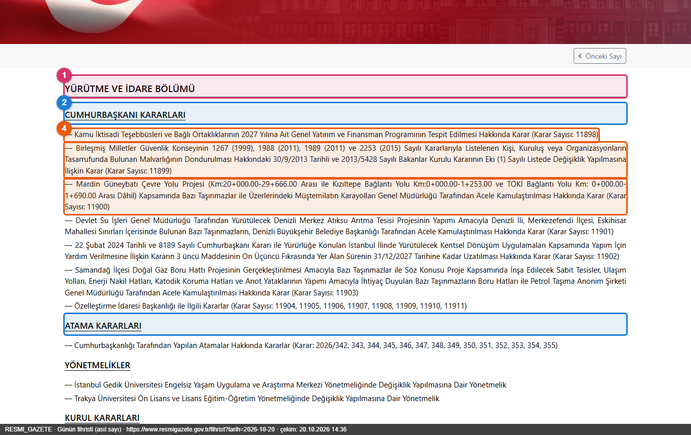 | 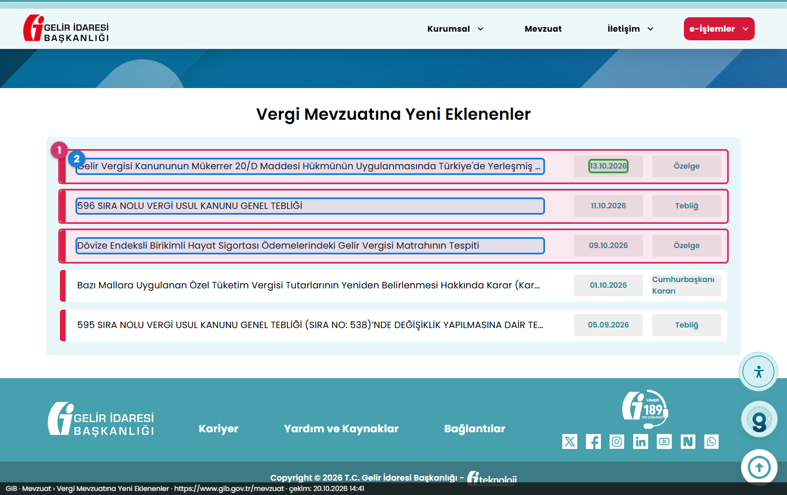 |

| TCMB — basın duyuruları | TCMB — Atom beslemesi |
|---|---|
|  |  |

| TCMB — bankacılık mevzuatı | MASAK — duyurular |
|---|---|
|  |  |

| MASAK — WordPress API | HMB — basın duyuruları |
|---|---|
|  |  |

| HMB — WordPress API | HMB — kanunlar |
|---|---|
|  |  |

| Ticaret — duyurular | Ticaret — tüketici mevzuatı |
|---|---|
|  |  |

| TKBB — duyurular | TKBB — idari düzenlemeler |
|---|---|
|  |  |

| BDDK — basın duyuruları | BDDK — Resmî Gazete kurul kararları |
|---|---|
| 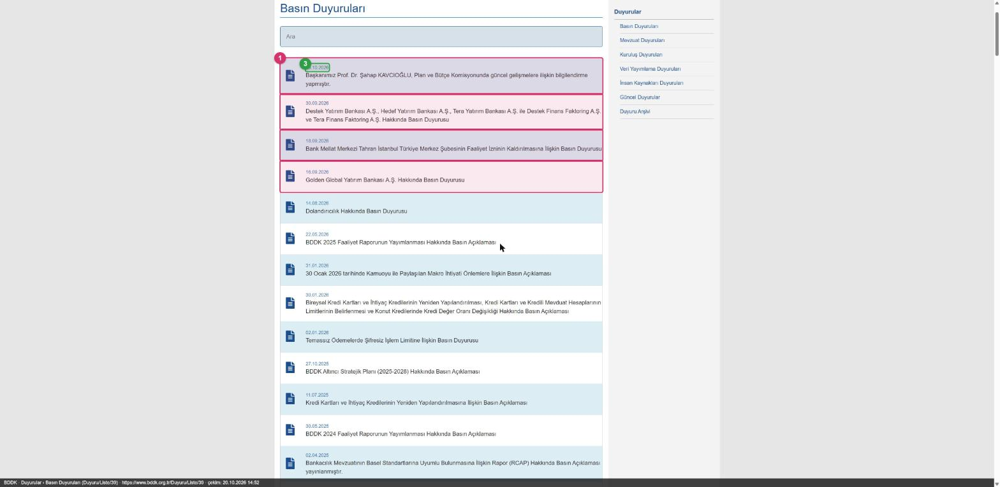 | 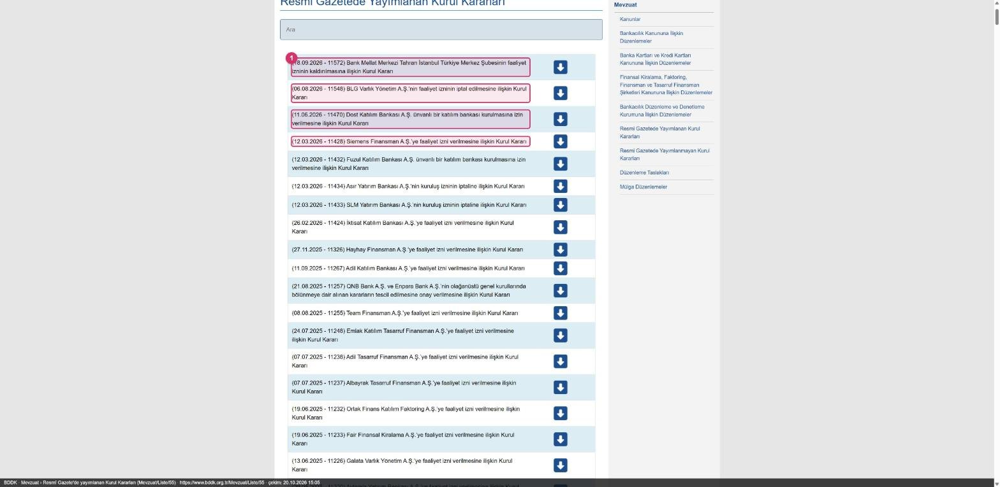 |

| BDDK — düzenlemeler | SPK — bültenler |
|---|---|
| 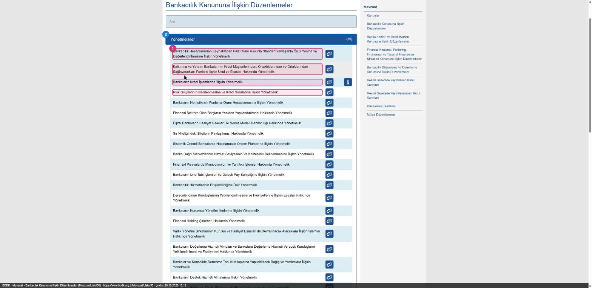 | 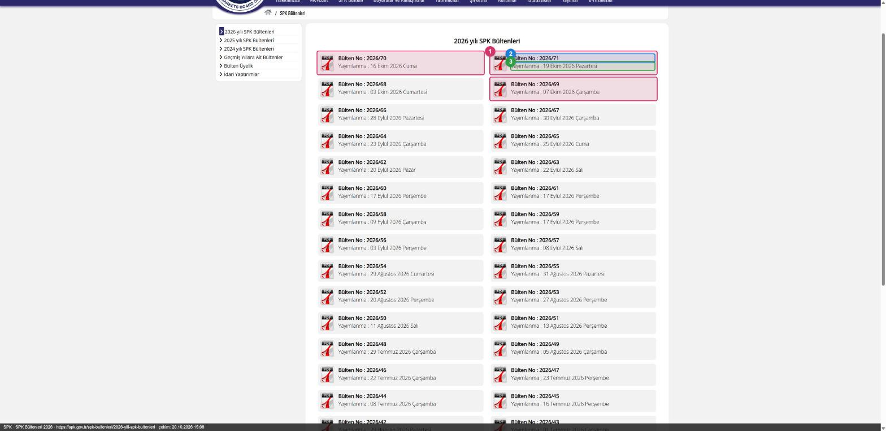 |

| SPK — basın duyuruları | SPK — mevzuat sistemi |
|---|---|
| 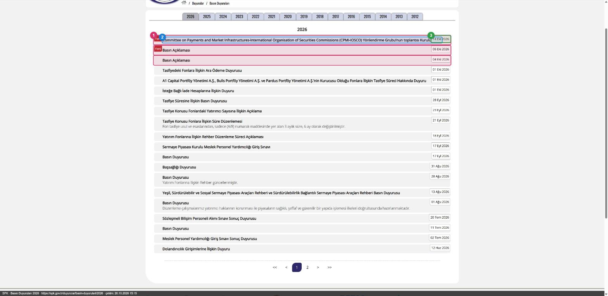 | 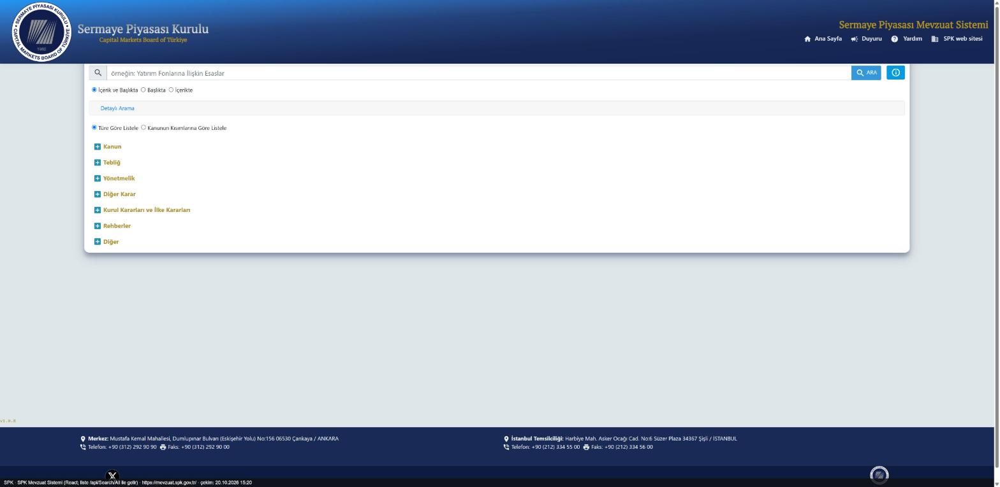 |

| KVKK — duyurular | KVKK — kurul kararları |
|---|---|
| 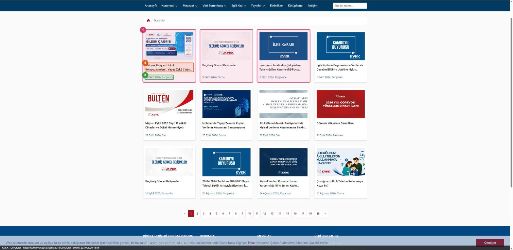 | 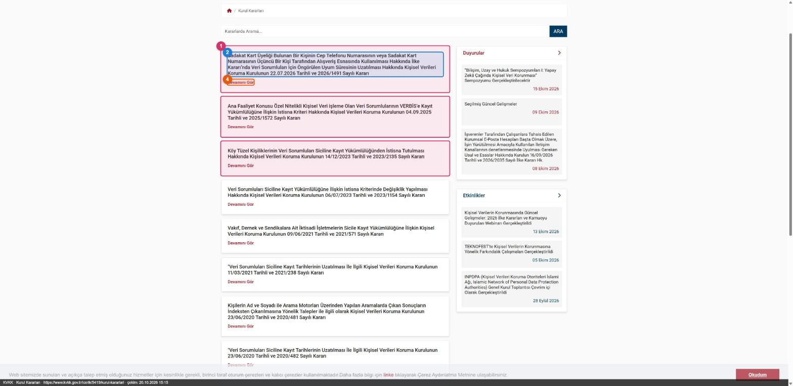 |

| KVKK — yönetmelikler | Rekabet — duyurular |
|---|---|
| 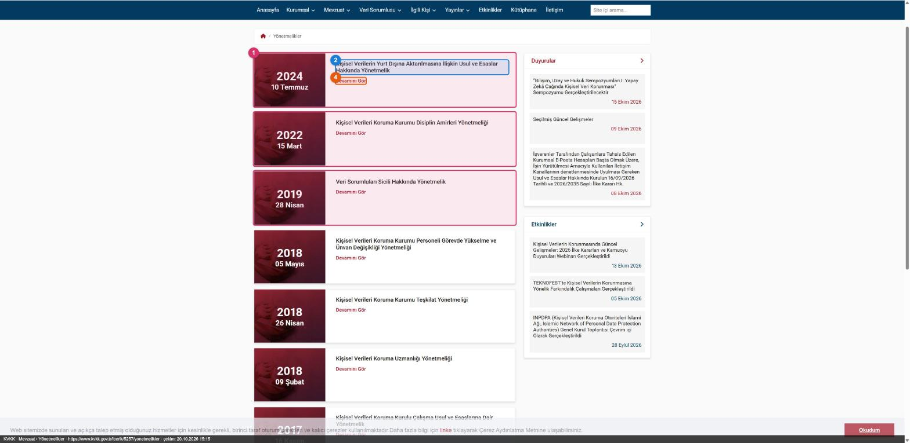 | 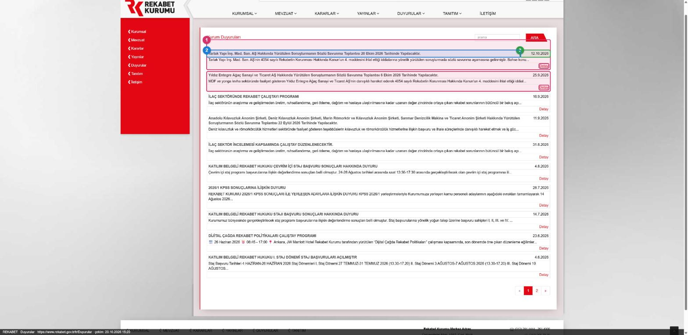 |

| Rekabet — kurul kararları | KGK — duyurular |
|---|---|
| 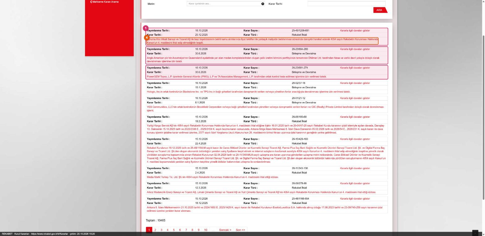 | 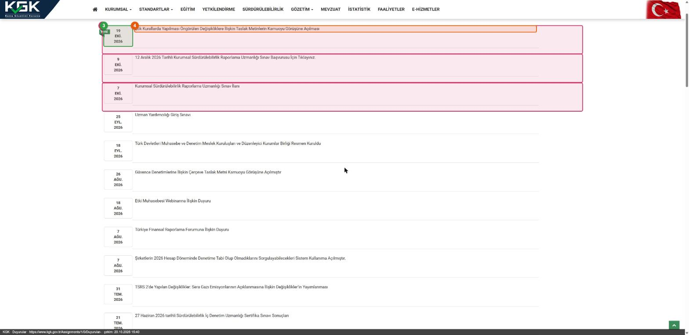 |

| KGK — son yayımlananlar | KGK — mevzuat |
|---|---|
| 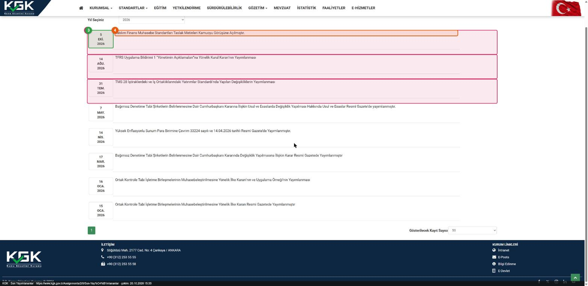 | 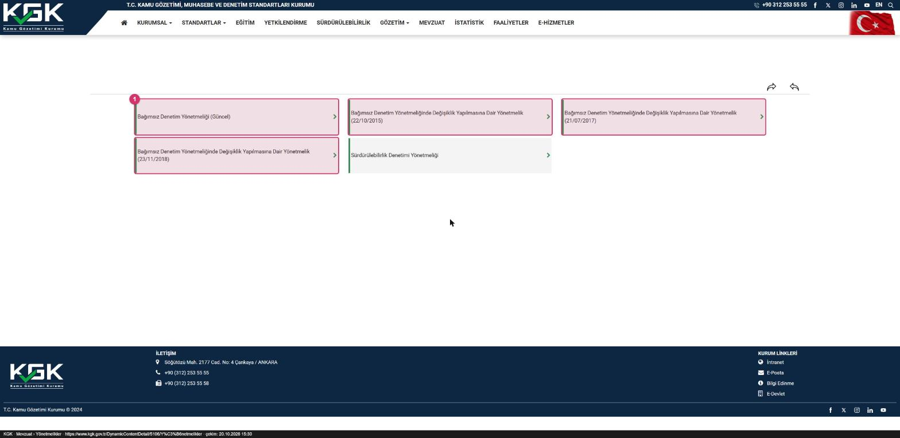 |

Tüm 12 kaynağın görüntüsü vardır. BDDK, SPK, KVKK, Rekabet Kurumu ve KGK siteleri otomasyonlu tarayıcıyı engellediği için bu beş kaynağın görüntüleri
gerçek bir Chrome tarayıcısında alındı (JPEG). Yöntem ve yenileme adımları: kılavuz §15.
