# Kaynak Tarama Kılavuzu — Crawler hangi sayfalara bakıyor?

**Kimler için:** Mevzuat ve Uyum Başkanlığı uzmanları (mutabakat toplantısı) ve projeyi sunan ekip.
**Amaç:** Sistemin hangi kurum sitelerinin hangi sayfalarını, hangi sıklıkla ve hangi alanları okuyarak taradığını **ekranda
görerek** doğrulamak. "Bu sayfa taranıyor mu? Şu duyuru buradan yakalanır mı? Bizim takip ettiğimiz başka bir sayfa eksik mi?"
sorularına birlikte cevap vermek.

Kılavuzdaki görüntüler **20.10.2026** tarihinde ilgili sitelerin canlı sayfaları açılarak alındı. Her görüntünün altında sayfanın
adresi ve çekim saati yazar; sayfaları kendiniz de açıp karşılaştırabilirsiniz.

---

## 1. Görüntüleri nasıl okumalı?

Görüntüler üzerindeki **numaralı renkli çerçeveler**, crawler'ın sayfada okuduğu alanları gösterir. Çerçeveler elle çizilmedi:
crawler'ın yapılandırmasındaki (`mevzuat-core/app/config/sources.yaml`) seçicilerle — seçici yapılandırmada yoksa aynı mantığı yansıtan
`scripts/kaynak_ekran_goruntusu.py` tanımlarıyla — sayfa üzerinde otomatik işaretlendi. Çerçevenin içinde kalan alan, crawler'ın
**okuduğu** alandır; dışında kalan alan okunmaz.

| İşaret | Anlamı |
|---|---|
| 🟥 **1** (kırmızı/pembe çerçeve) | **Kayıt**: listedeki her satır/kart ayrı bir kayıt olarak alınır. Görüntüde ilk 3 örnek çerçevelenir; aynı yapıdaki tüm satırlar taranır |
| 🟦 **2** (mavi) | **Başlık** |
| 🟩 **3** (yeşil) | **Yayım tarihi** (ya da sürüm/değişiklik tarihi) |
| 🟧 **4** (turuncu) | **Bağlantı**: kaydın ayrıntı sayfası ya da ek dosyası (PDF/Word) |

Görüntünün alt şeridinde kaynak, sayfa adı, adres ve çekim zamanı yazar.

### Crawler bir sayfayı nasıl işler? (1 dakikalık özet)

1. **Zamanı gelince** kaynağın liste sayfasını açar (tarama saatleri: [03 — Tarama takvimi](../ogrenme-rehberi/03-tarama-takvimi-ve-kaynaklar.md)).
2. Listedeki her kaydın **başlığını, tarihini ve bağlantısını** okur. Liste öğesi, ekranda görünen satır/karttır.
3. Daha önce görmediği kayıt **yeni** sayılır: ayrıntı sayfası ve ekleri (PDF, Word) indirilir, metni çıkarılır, yapay zekâ analizine girer.
   Daha önce görülen ama içeriği değişen kayıt **yeni sürüm** olur.
4. Bir kaynağın **ilk taramasında** sitede zaten duran eski kayıtlar analize girmez; **"İlk tarama"** olarak ayrılır ve
   portalın **Arşiv** ekranından sorgulanır (belirli bir tarihten sonrasını analize almak için Yönetim → Baseline sınırı).
5. Sitede hiçbir kayıt yokken liste hiç değişmediyse hiçbir şey olmaz; liste yapısı değişir ve crawler kayıt okuyamaz hale
   gelirse **"yapı değişti" uyarısı** üretir (portalın kaynak sağlığı şeridi).

> **Önemli sınır:** Crawler yalnızca aşağıda gösterilen **liste sayfalarında bağlantısı bulunan** kayıtları görür. Bir kurum
> bir içeriği bu sayfalara koymadan yayımlarsa (ör. yalnızca e-posta, sadece alt menüde bir sayfa), bu kılavuzdaki
> kapsamın dışındadır — mutabakatta tam olarak bu tür boşluklar aranmalıdır (bkz. §16).

---

## 2. Genel bakış: 12 kaynak, kaç sayfa?

| # | Kaynak | Kanal sayısı | Tarama sıklığı | Bu kılavuzda ekran görüntüsü |
|---|---|---|---|---|
| 1 | [Resmî Gazete](#rg) | 1 (fihrist) | günde 7 kez | ⛔ alınamadı (§15) |
| 2 | [BDDK](#bddk) | 7 | hafta içi saat başı 08–20 | ⛔ alınamadı (§15) |
| 3 | [SPK](#spk) | 3 | günde 2–3 kez | ⛔ alınamadı (§15) |
| 4 | [TCMB](#tcmb) | 2 | hafta içi günde 3 kez | ✅ |
| 5 | [KVKK](#kvkk) | 3 | günde 2–3 kez | ⛔ alınamadı (§15) |
| 6 | [MASAK](#masak) | 1 (API) | günde 2–3 kez | ✅ |
| 7 | [Ticaret Bakanlığı](#ticaret) | 2 | hafta içi günde 2 kez | ✅ |
| 8 | [Rekabet Kurumu](#rekabet) | 2 | hafta içi günde 2 kez | ⛔ alınamadı (§15) |
| 9 | [TKBB](#tkbb) | 2 | hafta içi günde 2 kez | ✅ |
| 10 | [Hazine ve Maliye Bakanlığı](#hmb) | 2 (API) | günde 2–3 kez | ✅ |
| 11 | [Gelir İdaresi Başkanlığı](#gib) | 8 (API) | günde 2–4 kez | ⛔ alınamadı (§15) |
| 12 | [KGK](#kgk) | 3 | hafta içi günde 2 kez | ⛔ alınamadı (§15) |

> ⛔ **Dürüst not:** Bu kılavuz hazırlanırken kullanılan bulut ortamından 12 sitenin 5'ine (TCMB, MASAK, TKBB, HMB, Ticaret)
> erişilebildi. Diğer siteler bu ortamın internet çıkışını engelliyor (ayrıntı §15). **Engel sayfası görüntüleri kılavuza
> konmadı, ekran görüntüsü uydurulmadı.** Bu kaynakların bölümlerinde taranan adresler ve okunan alanlar metin olarak
> yer alıyor; görüntüler, kurum ağından tek komutla alınıp kılavuza eklenebilir (§15).

---

<a id="rg"></a>

## 3. Resmî Gazete (`RESMI_GAZETE`)

| | |
|---|---|
| Adres | <https://www.resmigazete.gov.tr/fihrist?tarih=YYYY-MM-DD> (asıl sayı); `&mukerrer=N` mükerrer sayı |
| Sıklık | Günde **7 kez**: 00:10 · 02:30 · 07:30 · 12:00 · 17:00 · 21:00 · 23:45 (hafta sonu dahil) |
| Kapsam | Her taramada **bugün + dün**; asıl sayı + en çok 4 mükerrer |

**Ne toplanır?** Günün fihristindeki her **madde** (kanun, yönetmelik, tebliğ, kurul kararı, atama…) ayrı bir kayıt olur.
Maddeler `/eskiler/YYYY/MM/YYYYMMDD-N.htm|pdf` bağlantılarıdır.

**Ne toplanmaz?** **İLÂN BÖLÜMÜ** bütünüyle alınmaz. İstisna: *"Çeşitli İlânlar"* dizini açılır ve **yalnızca ilan veren
kurumu aşağıdaki listeye uyan ilanlar** ayrı kayıt olarak alınır (ör. bir bankanın faaliyet izninin iptali):

> BDDK · TCMB · SPK · MASAK · Tasarruf Mevduatı Sigorta Fonu · KVKK · Rekabet Kurumu · Ticaret Bakanlığı · Sigortacılık ve Özel
> Emeklilik Düzenleme ve Denetleme Kurumu · Hazine ve Maliye Bakanlığı · Katılım Bankaları Birliği / Bankalar Birliği ·
> Borsa İstanbul / Merkezî Kayıt Kuruluşu / Takasbank

**Neden günde 7 kez?** Mükerrer sayılar gün içinde, bazen gece geç saatte yayımlanabiliyor; gece yarısına yakın pencereler bu yüzden var.

**Beklenen sayfa yapısı** (yapılandırmadan): fihrist `#html-content` içinde bölüm başlığı (`YÜRÜTME VE İDARE BÖLÜMÜ`, `İLÂN BÖLÜMÜ` …),
alt başlık (`YÖNETMELİKLER`, `TEBLİĞLER` …) ve madde bağlantılarından oluşur.

*Ekran görüntüsü: alınamadı (§15). Komut: `python scripts/kaynak_ekran_goruntusu.py RESMI_GAZETE` → `img/rg-fihrist.png`*

**Mutabakat soruları:** İLÂN BÖLÜMÜ'ndeki kurum listesi Başkanlığın izlediği kurumları kapsıyor mu? Listede olmayan ama izlenmesi gereken bir
ilan veren kurum var mı?

---

<a id="bddk"></a>

## 4. BDDK (`BDDK`)

| | |
|---|---|
| Sıklık | Hafta içi **saat başı 08:00–20:00** (günde 13 kez), hafta sonu yok |
| Not | Site yurt dışı IP'lerine kapalı; crawler kurum ağındaki DMZ'den çalışır |

**Taranan 7 kanal** (hepsi liste sayfasındaki bağlantıları okur):

| Kanal | Taranan sayfa | Sitedeki karşılığı |
|---|---|---|
| `duyurular` | <https://www.bddk.org.tr/Duyuru/Liste/39> | Duyurular › **Basın Duyuruları** |
| `mevzuat_duyurulari` | <https://www.bddk.org.tr/Duyuru/Liste/40> | Duyurular › **Mevzuat Duyuruları** |
| `kurulus_duyurulari` | <https://www.bddk.org.tr/Duyuru/Liste/48> | Duyurular › **Kuruluş Duyuruları** (karar tarihi/sayısı başlıktan ayrıştırılır) |
| `rg_kurul_kararlari` | <https://www.bddk.org.tr/Mevzuat/Liste/55> | Mevzuat › **Resmî Gazete'de yayımlanan Kurul Kararları** |
| `kurul_kararlari` | <https://www.bddk.org.tr/Mevzuat/Liste/56> | Mevzuat › **Yayımlanmayan Kurul Kararları** |
| `duzenleme_taslaklari` | <https://www.bddk.org.tr/Mevzuat/Liste/58> | Mevzuat › **Düzenleme Taslakları** |
| `duzenlemeler` | Mevzuat/Liste/**49, 50, 51, 52** | Kanunlar · Bankacılık Kanununa İlişkin Düzenlemeler (akordeon: yönetmelik, genelge, tebliğ, rehber…) · Banka ve Kredi Kartları · Finansal Kiralama/Faktoring/Finansman |

- Duyuruların asıl metni çoğunlukla **ek PDF**'tedir (`/Duyuru/EkGetir/…`); ekler indirilir ve metni çıkarılır.
- Kanun ve yönetmelik bağlantıları **mevzuat.gov.tr**'ye gider; tam metin oradan alınır.
- `duzenlemeler` kanalı konsolide metinlerin yerinde güncellenmesi nedeniyle **14 günde bir** yeniden kontrol edilir.

**Bilerek taranmayanlar:** Duyuru/Liste **41** (İK), **42** (veri), Mevzuat/Liste **54** (Kurum iç düzenlemeleri), **63** (mülga).

*Ekran görüntüsü: alınamadı (§15). Komut: `python scripts/kaynak_ekran_goruntusu.py BDDK` → `img/bddk-*.png`*

**Mutabakat soruları:** Başkanlığın izlediği başka bir BDDK sayfası (ör. yönetmelik değişiklik özetleri, sektör verileri) var mı? İK ve iç düzenleme
listelerinin kapsam dışı olması uygun mu?

---

<a id="spk"></a>

## 5. SPK (`SPK`)

| | |
|---|---|
| Sıklık | Hafta içi 09:00 · 14:00; her gün 19:30 |

| Kanal | Taranan adres | Ne toplanır |
|---|---|---|
| `bultenler` | <https://spk.gov.tr/spk-bultenleri/2026-yili-spk-bultenleri> (yıl otomatik) | Haftalık/olağanüstü **SPK Bültenleri** (PDF); düzenlemeler bültende yayımlanır |
| `basin_duyurulari` | <https://spk.gov.tr/duyurular/basin-duyurulari/2026> (yıl otomatik) | **Basın duyuruları** |
| `mevzuat` | <https://mevzuat.spk.gov.tr/> (React ön yüz; liste `/api/Search/All` JSON uç noktasından) | Tebliğ, yönetmelik, rehber, ilke kararlarının **güncel (konsolide) metinleri**; 14 günde bir yeniden kontrol |

*Ekran görüntüsü: alınamadı (§15). Komut: `python scripts/kaynak_ekran_goruntusu.py SPK`*

**Mutabakat soruları:** Bültenler dışındaki "Kurul Karar Organı" kararları ayrıca izlenmeli mi? Yıl sayfası takvim yılına göre otomatik seçilir; bu yeterli mi?

---

<a id="tcmb"></a>

## 6. TCMB (`TCMB`)

| | |
|---|---|
| Sıklık | Hafta içi **09:00 · 14:30 · 19:00** |
| Kanallar | `basin_duyurulari` (Atom/RSS beslemesi), `mevzuat` (6 sayfa) |

### 6.1 Basın duyuruları

Crawler **Atom beslemesini** okur; aynı içerik sitedeki *Duyurular ve Konuşmalar › Basın Duyuruları* sayfasında görünür. Önce sitedeki görünüm:

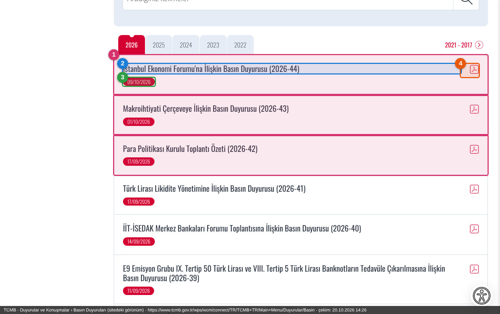

*<https://www.tcmb.gov.tr/wps/wcm/connect/TR/TCMB+TR/Main+Menu/Duyurular/Basin> — her satır bir basın duyurusudur.*

| İşaret | Alan |
|---|---|
| 1 | Basın duyurusu satırı |
| 2 | Başlık (ör. *"İstanbul Ekonomi Forumu'na İlişkin Basın Duyurusu (2026-44)"*) |
| 3 | Yayım tarihi (`09/10/2026`) |
| 4 | PDF eki |

Crawler'ın okuduğu besleme — aynı duyuru, makine okunur biçimde:

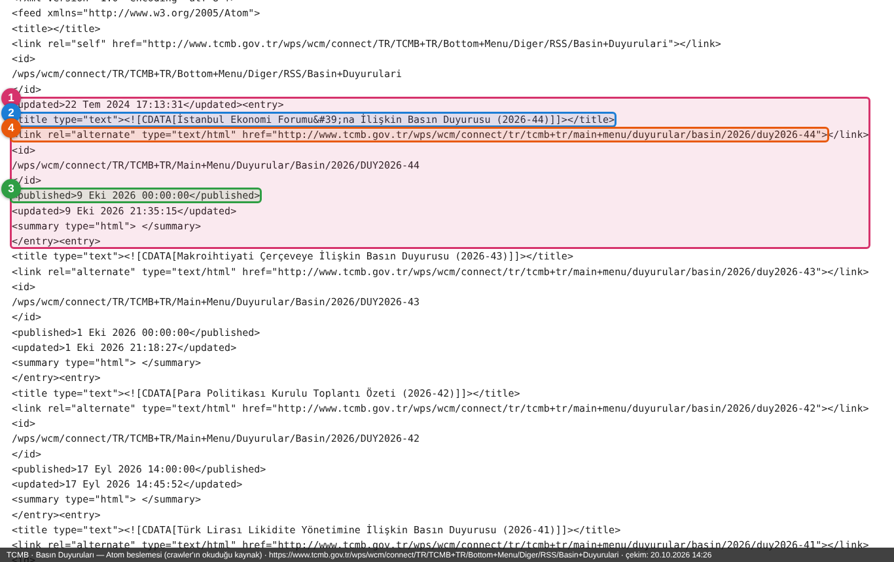

*<https://www.tcmb.gov.tr/wps/wcm/connect/TR/TCMB+TR/Bottom+Menu/Diger/RSS/Basin+Duyurulari> — ham besleme.*

| İşaret | Alan |
|---|---|
| 1 | `<entry>` = bir duyuru |
| 2 | Başlık |
| 3 | Yayım tarihi (`<published>`) |
| 4 | Duyuru bağlantısı (`DUY2026-44` gibi duyuru numarası kimlik olur) |

> Not: Beslemenin en üstündeki genel `<updated>` alanı eski bir tarih (22 Tem 2024) gösteriyor; her duyurunun kendi tarihi günceldir ve
> crawler duyuruları tek tek okur. Bu alan taramayı etkilemez.

### 6.2 Mevzuat (6 sayfa, belge listeleri)

| Taranan sayfa (…/Banka+Hakkinda/Mevzuat/…) |
|---|
| [Bankacılık](https://www.tcmb.gov.tr/wps/wcm/connect/TR/TCMB+TR/Main+Menu/Banka+Hakkinda/Mevzuat/Bankacilik/) · [Kambiyo](https://www.tcmb.gov.tr/wps/wcm/connect/TR/TCMB+TR/Main+Menu/Banka+Hakkinda/Mevzuat/Kambiyo/) · [Ödeme Sistemleri](https://www.tcmb.gov.tr/wps/wcm/connect/TR/TCMB+TR/Main+Menu/Banka+Hakkinda/Mevzuat/Odeme+Sistemleri/) · [Piyasalar](https://www.tcmb.gov.tr/wps/wcm/connect/TR/TCMB+TR/Main+Menu/Banka+Hakkinda/Mevzuat/Piyasalar/) · [Operasyon](https://www.tcmb.gov.tr/wps/wcm/connect/TR/TCMB+TR/Main+Menu/Banka+Hakkinda/Mevzuat/Operasyon+Mevzuat/) · [İstatistik](https://www.tcmb.gov.tr/wps/wcm/connect/TR/TCMB+TR/Main+Menu/Banka+Hakkinda/Mevzuat/Istatistik/) |

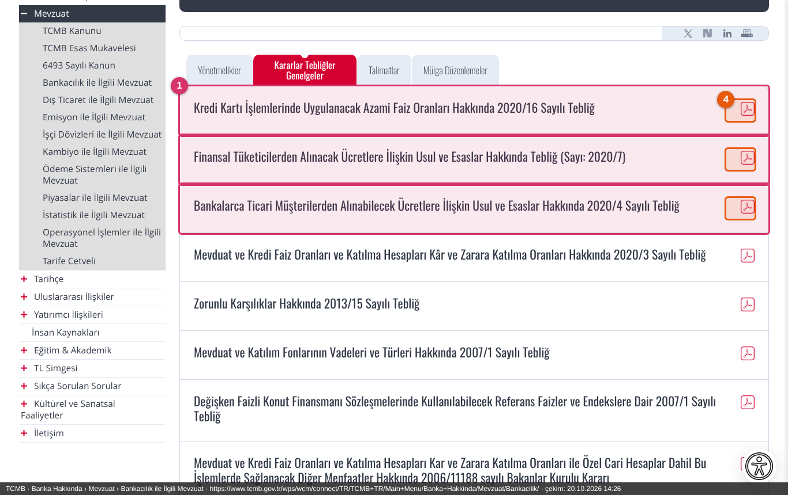

*Görüntüde "Kararlar / Tebliğler / Genelgeler" sekmesi açık. Sayfada **Yönetmelikler · Kararlar-Tebliğler-Genelgeler · Talimatlar · Mülga Düzenlemeler** sekmeleri
var; crawler sayfanın tüm sekmelerindeki bağlantıları okur.*

| İşaret | Alan |
|---|---|
| 1 | Belge satırı |
| 4 | PDF bağlantısı (`/wps/wcm/connect/<kimlik>/…`) |

- Bu sayfalar **tarihsiz belge listeleridir**. Bağlantıdaki `CACHEID` değeri belge güncellendiğinde değişir; crawler bunu **yeni sürüm** işareti sayar.
- Sayfada tarih bulunmadığı için yayım tarihi yoktur; kayıt "tespit tarihi" ile görünür.

**Mutabakat soruları:** TCMB'nin Resmî Gazete'de yayımlanan tebliğleri RG kaynağından da gelir; ek olarak 6 mevzuat sayfası yeterli mi?
Menüdeki *Dış Ticaret, Emisyon, İşçi Dövizleri* mevzuat sayfaları ile *TCMB Kanunu, Esas Mukavelesi, 6493 Sayılı Kanun, Tarife Cetveli* sayfaları taranmıyor — kapsam dışı kalması uygun mu?

---

<a id="kvkk"></a>

## 7. KVKK (`KVKK`)

| | |
|---|---|
| Sıklık | Hafta içi 09:00 · 15:00; her gün 20:00 |

| Kanal | Taranan sayfa | Ne toplanır |
|---|---|---|
| `duyurular` | <https://www.kvkk.gov.tr/Icerik/2015/Duyurular> | Duyuru kutuları (`.news__box`); PDF ekleri |
| `kurul_kararlari` | <https://www.kvkk.gov.tr/Icerik/5419/kurul-kararlari> | Kurul kararı listesi (karar tarihi ve sayısı başlıktan ayrıştırılır) |
| `mevzuat` | [Yönetmelikler](https://www.kvkk.gov.tr/Icerik/5257/yonetmelikler) · [Tebliğler](https://www.kvkk.gov.tr/Icerik/5258/tebligler) · [Rehberler](https://www.kvkk.gov.tr/Icerik/2030/rehberler) | Mevzuat listeleri |

Kurul kararı ve yönetmelik bağlantılarının çoğu **doğrudan Resmî Gazete'ye** gider. Bu durumda crawler yalnızca liste satırını saklar;
içeriğin kendisi Resmî Gazete kaynağından gelir ve sistem ikisini **tek düzenleme kaydında birleştirir**.

*Ekran görüntüsü: alınamadı (§15). Komut: `python scripts/kaynak_ekran_goruntusu.py KVKK`*

**Mutabakat soruları:** Yukarıdaki üç liste dışında Başkanlığın takip ettiği KVKK sayfaları (varsa: kurul karar özetleri, veri ihlali bildirimleri, yayınlar) var mı?

---

<a id="masak"></a>

## 8. MASAK (`MASAK`)

| | |
|---|---|
| Sıklık | Hafta içi 09:00 · 15:00; her gün 20:00 |
| Kanal | `icerik` — WordPress API (`posts` + `pages`), son 30 gün, sayfa başına 50, en çok 3 sayfa |

MASAK sitesi bir React uygulamasıdır; ekrandaki duyurular **WordPress REST API**'sinden gelir. Crawler HTML sayfasını değil API'yi okur,
böylece sitenin tasarımı değişse de tarama bozulmaz. Önce sitedeki görünüm:

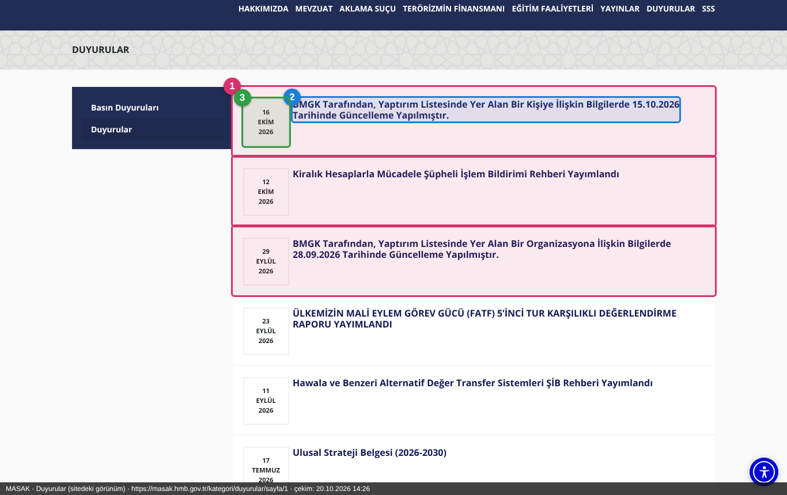

*<https://masak.hmb.gov.tr/kategori/duyurular/sayfa/1> — sitedeki "Duyurular" listesi.*

| İşaret | Alan |
|---|---|
| 1 | Duyuru (API'de bir `post`) |
| 2 | Başlık ve ayrıntı bağlantısı |
| 3 | Yayım tarihi |

Crawler'ın okuduğu API yanıtı (görüntüde yanıt kısaltıldı; gerçek yanıtta duyurunun tam metni `content` alanında gelir):

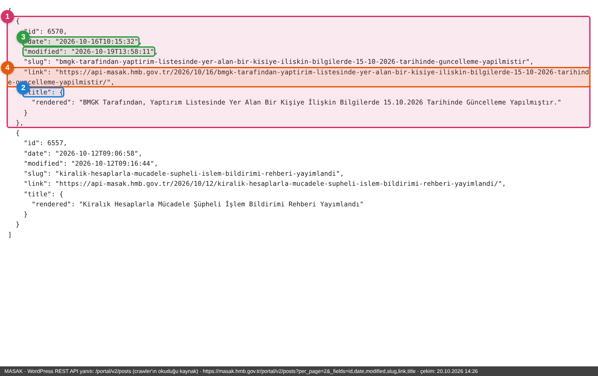

*<https://masak.hmb.gov.tr/portal/v2/posts>*

| İşaret | Alan |
|---|---|
| 1 | Bir kayıt (`post`) |
| 2 | `title` — başlık |
| 3 | `date` (yayım) ve `modified` (değişiklik): **artımlı tarama** ve **sürüm anahtarı** |
| 4 | `link` — API iç adresi gösterir; herkese açık adrese (`masak.hmb.gov.tr`) çevrilir |

- **Sessiz günlerde boş liste normaldir** (MASAK'ın yayın sıklığı düşüktür; izleme 336 saat sessizliği tolere eder).
- Metin içindeki **PDF/Word ek bağlantıları** (`ms.hmb.gov.tr/uploads/…`) indirilir.
- `pages` uç noktası site sayfalarını da kapsar; bir sayfanın `modified` değeri değişince yeni sürüm açılır.

**Mutabakat soruları:** *Mevzuat*, *Aklama Suçu*, *Terörizmin Finansmanı* menülerindeki yönlendirme/rehber sayfaları ve *Yaptırım listesi güncellemeleri*
duyuru olarak geliyor; bu kapsam yeterli mi? *Yayınlar* menüsü (rehberler, raporlar) ayrıca izlenmeli mi?

---

<a id="ticaret"></a>

## 9. Ticaret Bakanlığı (`TICARET`)

| | |
|---|---|
| Sıklık | Hafta içi 10:00 · 16:00 |
| İstemci | Tarayıcı TLS parmak izi taklitli istemci (`impersonate`) |

> Bu siteye hazırlık ortamından erişim kararsızdı (bazı denemelerde bağlantı reddedildi); aşağıdaki görüntüler başarılı denemede alındı.

### 9.1 Duyurular

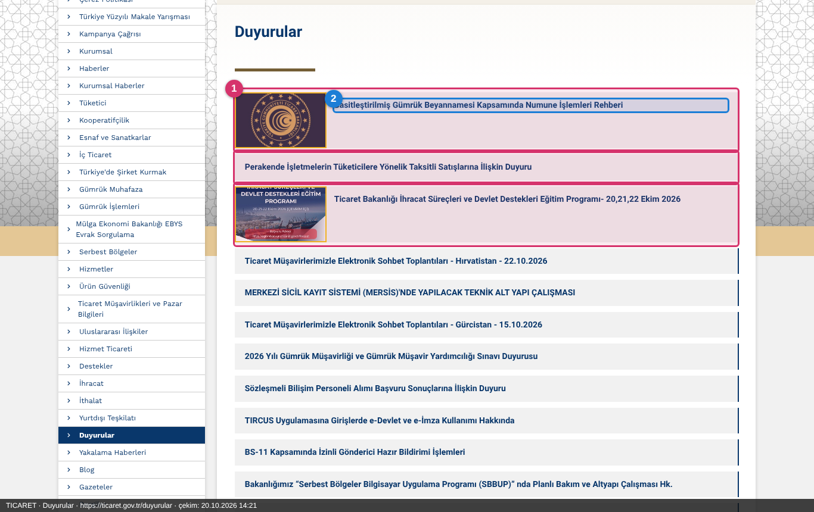

*<https://ticaret.gov.tr/duyurular> — ilk sayfa ve 2. sayfa taranır.*

| İşaret | Alan |
|---|---|
| 1 | Duyuru satırı (`ul.dizin-content li`) |
| 2 | Başlık |

Liste satırlarında **tarih görünmez**.

### 9.2 Tüketici mevzuatı

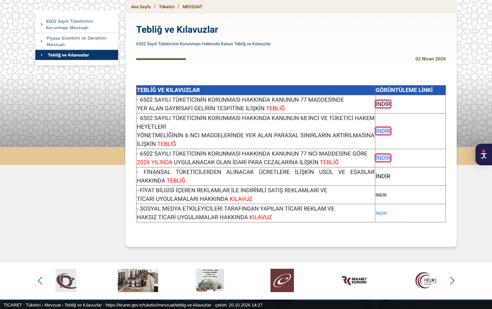

*<https://ticaret.gov.tr/tuketici/mevzuat/teblig-ve-kilavuzlar>*

| İşaret | Alan |
|---|---|
| 1 | "İNDİR" bağlantısı: `mevzuat.gov.tr` mevzuat sayfasına ya da `/data/<kimlik>/…` dosyasına gider |

- Bağlantılar **mevzuat.gov.tr**'ye gittiği için tam metin oradan alınır; konsolide metinler yerinde güncellendiği için **14 günde bir** yeniden kontrol edilir.
- Tablodaki tebliğ/kılavuz satırlarının yanında tarih yoktur; sayfanın üstünde tek bir tarih (*"02 Nisan 2026"*) görünür.
- Bakanlık tebliğleri ayrıca Resmî Gazete'den de gelir ve sistem tarafından birleştirilir.

**Mutabakat soruları:** Soldaki *6502 Sayılı Tüketicinin Korunması Mevzuatı* ve *Piyasa Gözetimi ve Denetimi Mevzuatı* menüleri taranmıyor — kapsam dışı kalması uygun mu?
*Haberler* ve *Blog* bölümleri izlenmiyor.

---

<a id="rekabet"></a>

## 10. Rekabet Kurumu (`REKABET`)

| | |
|---|---|
| Sıklık | Hafta içi 10:00 · 17:00 |

| Kanal | Taranan sayfa | Ne toplanır |
|---|---|---|
| `duyurular` | <https://www.rekabet.gov.tr/tr/Duyurular> | Duyuru bağlantıları (`/tr/Duyurular/…-<32 hane>`), başlık `.tablotitle`, tarih sağ sütun |
| `kurul_kararlari` | <https://www.rekabet.gov.tr/tr/Kararlar> | Karar tabloları (`#kararList`): **karar sayısı, karar tarihi, karar türü, yayımlanma tarihi** |

Kurul kararı hacmi yüksektir; **ilgililik filtresi bu kaynakta en çok elemeyi yapar**. Elenen kararları Arşiv ekranında görebilirsiniz.

*Ekran görüntüsü: alınamadı (§15). Komut: `python scripts/kaynak_ekran_goruntusu.py REKABET`*

**Mutabakat soruları:** Birleşme/devralma bildirimleri ve *Kurul Karar Özetleri* ayrıca izlenmeli mi? Bankacılıkla ilgisiz kararların elenmesi beklentiyle uyumlu mu?

---

<a id="tkbb"></a>

## 11. TKBB (`TKBB`)

| | |
|---|---|
| Sıklık | Hafta içi 10:00 · 17:00 |
| Not | Katılım bankacılığı için yüksek ilgililik beklenir |

### 11.1 Duyurular

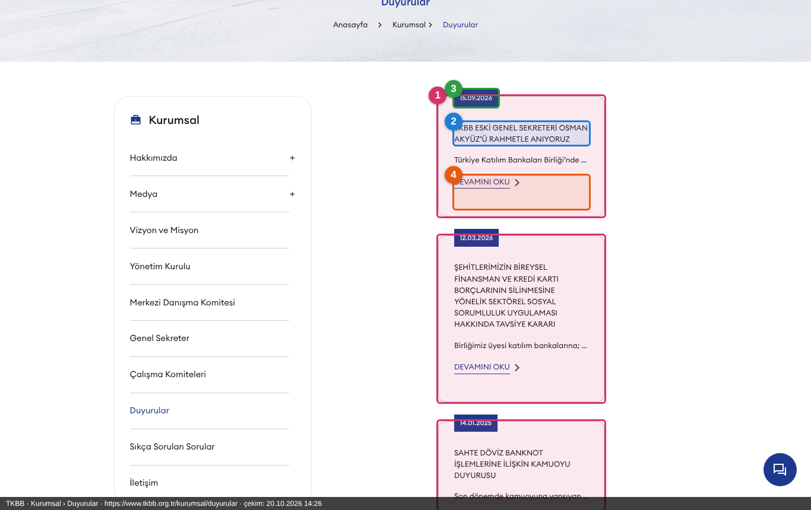

*<https://www.tkbb.org.tr/kurumsal/duyurular>*

| İşaret | Alan |
|---|---|
| 1 | Duyuru kartı: kartın tamamı bir bağlantıdır (`/kurumsal/duyurular/<ad>`) |
| 2 | Başlık |
| 3 | Yayım tarihi (kartın üstündeki mavi etiket) |
| 4 | "DEVAMINI OKU": ayrıntı sayfası |

### 11.2 Birliğimiz düzenlemeleri

Taranan iki sayfa: [İdari Düzenlemeler](https://www.tkbb.org.tr/mevzuat/birligimiz-duzenlemeleri/idari-duzenlemeler) ve
[Mesleki Düzenlemeler](https://www.tkbb.org.tr/mevzuat/birligimiz-duzenlemeleri/mesleki-duzenlemeler).

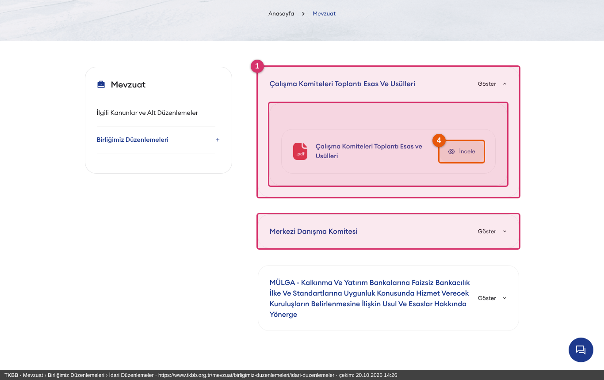

*Görüntüde ilk başlık "Göster" ile açıldı. Sayfadaki tüm gruplar (Çalışma Komiteleri, Merkezi Danışma Komitesi, mülga düzenlemeler…) taranır.*

| İşaret | Alan |
|---|---|
| 1 | Düzenleme grubu (açılır başlık) |
| 4 | Düzenleme belgesi: `…-details/<no>` sayfası ya da `/upload/….pdf|doc` dosyası ("İncele") |

**Mutabakat soruları:** *Mevzuat › İlgili Kanunlar ve Alt Düzenlemeler* ve *Banka ve Sektör Bilgileri* bölümleri taranmıyor. Katılım bankacılığı
standart/ilke belgeleri bu sayfalarda mı? *"MÜLGA"* ibareli düzenlemeler de listeye giriyor; bu istenen davranış mı?

---

<a id="hmb"></a>

## 12. Hazine ve Maliye Bakanlığı (`HMB`)

| | |
|---|---|
| Sıklık | Hafta içi 09:00 · 14:00; her gün 19:00 |
| Kanallar | `duyurular` (WordPress `posts`), `sayfalar` (WordPress `pages`) |

HMB sitesi MASAK ile **aynı altyapıdadır** (React ön yüz + WordPress API). Son 30 gün, artımlı tarama.

### 12.1 Duyurular (posts)

Haberler dahil, **Sınav Duyuruları hariç** (kategori 20). Kategoriler: Kamu Finansmanı, Kamu Sermayeli Kuruluş ve İşletmeler, Dış Ekonomik İlişkiler,
Kamu Mali Yönetim ve Dönüşüm, Finansal Piyasalar ve Kambiyo, Ekonomik Programlar ve Araştırmalar, Strateji Geliştirme, İç Denetim Koordinasyon Kurulu,
Devlet Muhasebesi Standartları Kurulu, Vergi Denetim Kurulu, Bakanlık Duyurusu, Basın Duyurusu, Haber.

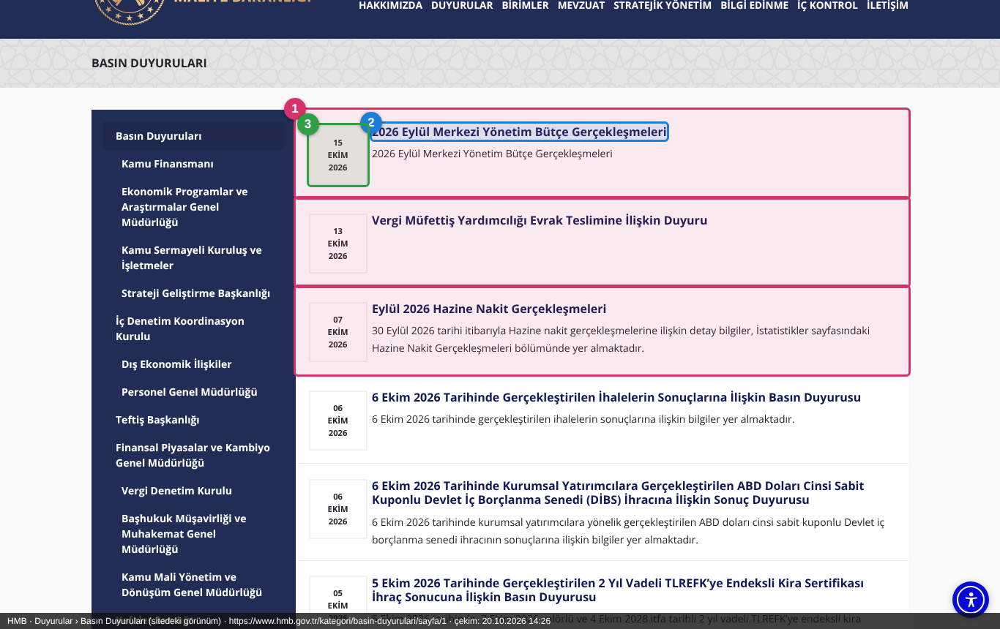

*<https://www.hmb.gov.tr/kategori/basin-duyurulari/sayfa/1> — sitedeki kategori sayfası. Ayrıntı adresi `/duyuru/<ad>` biçimindedir.*

| İşaret | Alan |
|---|---|
| 1 | Duyuru (API'de bir `post`) |
| 2 | Başlık ve ayrıntı bağlantısı |
| 3 | Yayım tarihi |

Crawler'ın okuduğu API yanıtı:

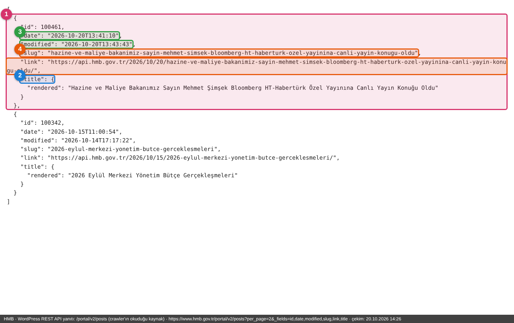

*<https://www.hmb.gov.tr/portal/v2/posts>*

| İşaret | Alan |
|---|---|
| 1 | Bir kayıt |
| 2 | `title` |
| 3 | `date` ve `modified` (artımlı tarama + sürüm anahtarı) |
| 4 | `link` ve `slug`: API iç adresi gösterir; ön yüz adresi `/duyuru/<slug>` şablonundan üretilir |

### 12.2 Sayfalar (mevzuat sayfaları)

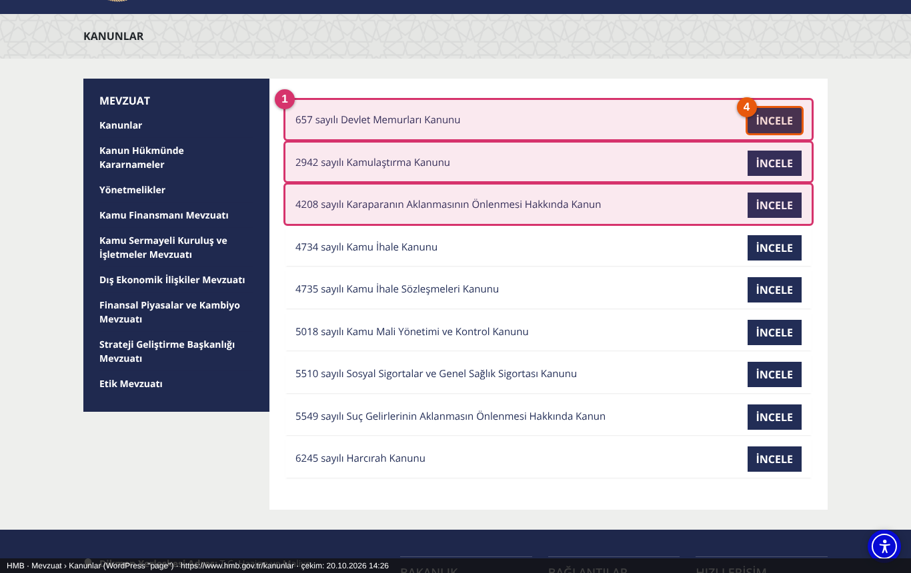

*<https://www.hmb.gov.tr/kanunlar> — Mevzuat menüsü: Kanunlar · Kanun Hükmünde Kararnameler · Yönetmelikler · Kamu Finansmanı · Kamu Sermayeli Kuruluş ve İşletmeler · Dış Ekonomik İlişkiler · Finansal Piyasalar ve Kambiyo · Strateji Geliştirme · Etik Mevzuatı.*

| İşaret | Alan |
|---|---|
| 1 | Mevzuat satırı |
| 4 | "İNCELE": `mevzuat.gov.tr` bağlantısı — **dış site olduğu için içeriği alınmaz**; yalnızca sayfanın kendi sürümü (değişiklik tarihi) izlenir |

**Mutabakat soruları:** *Mevzuat* altındaki sayfalarda yeni bir kanun/yönetmelik **eklendiğinde** sayfa değişir ve yeni sürüm oluşur; ancak bağlantı hedefindeki (mevzuat.gov.tr)
metin değişikliği izlenmez. Bu yeterli mi? Sınav duyurularının hariç tutulması uygun mu? *Birimler* menüsü (genel müdürlük sayfaları) taranmıyor.

---

<a id="gib"></a>

## 13. Gelir İdaresi Başkanlığı (`GIB`)

| | |
|---|---|
| Sıklık | 08:30 (her gün) · 13:00 ve 18:00 (hafta içi) · 22:30 (her gün) |
| İstek aralığı | 2 sn (siteyi yormamak için) |

GİB portalı bir Next.js uygulamasıdır; detay sayfalarının metni HTML'de bulunmaz. Crawler, ön yüzün kullandığı **`/api/gibportal/…` JSON uç noktalarını** okur
(yalnızca POST kabul eder); metin yanıtta gelir, ekler `cdn.gib.gov.tr`'den indirilir.

| Kanal | Taranan içerik | Not |
|---|---|---|
| `ozelgeler` | **Özelgeler** | son sayfalar, kesinti sonrası 10 sayfaya kadar telafi |
| `sirkulerler` | **Sirküler** | |
| `tebligler` | **Tebliğler** | tebliğlerin %98'ini içeren **17 kanun** ayrı ayrı sorgulanır (GVK, VUK, KVK, KDV, ÖTV …); kanun başına RG tarihine göre ilk 5 |
| `cbk` | **Cumhurbaşkanı Kararları** | |
| `ic_genelgeler` | **İç Genelgeler** | |
| `yonetmelikler` | **Yönetmelikler** | en yeni 20 |
| `taslaklar` | **Taslaklar** | |
| `mevzuat_duyurulari` | **Mevzuat duyuruları** | |

**Bilerek izlenmeyenler** (13.10.2026 kararı): Bakanlar Kurulu Kararları (2018'den beri yeni yok), Genel Yazılar, KKDF ve uluslararası mevzuat, kanun gerekçeleri
ve madde metinleri, Sistem/Uygulama duyuruları, Sınav/Kariyer duyuruları, Defterdarlık duyuruları.

*Ekran görüntüsü: alınamadı (§15). Komut: `python scripts/kaynak_ekran_goruntusu.py GIB` (GİB'in liste uçları yalnız POST kabul ettiği için görüntü işaretsiz portal ekranıdır).*

**Mutabakat soruları:** Vergi mevzuatı bankacılık için hangi ölçüde izlenmeli? Özelge ve sirkülerlerin her biri analize giriyor; ilgililik filtresi bunların çoğunu eleyecektir.
*Genel Yazılar* ve *Uluslararası mevzuat* dışarıda kalıyor.

---

<a id="kgk"></a>

## 14. KGK (`KGK`)

| | |
|---|---|
| Sıklık | Hafta içi 10:00 · 17:00 |

| Kanal | Taranan sayfa | Ne toplanır |
|---|---|---|
| `duyurular` | <https://www.kgk.gov.tr/Assignments/1/0/Duyurular-> | Duyurular (`.v2-announcement-item`); bağlantı detay sayfasına, PDF'e ya da Resmî Gazete'ye gider |
| `son_yayimlananlar` | <https://www.kgk.gov.tr/Assignments/2/0/Son-Yay%C4%B1mlananlar> | Standart ve kurul kararı yayımları |
| `mevzuat` | 10 sayfa: Kanunlar/KHK · Cumhurbaşkanı Kararları · Yönetmelikler · Tebliğler · Kurul Kararları · Eğitim ve Yetkilendirme · Gözetim · Diğer · Kurumsal Düzenlemeler · Uluslararası Düzenlemeler (`/DynamicContentDetail/…`) | Mevzuat ağacı; alt sayfalar `data-href` ile bağlanır; **7 günde bir** yeniden kontrol |

Resmî Gazete'ye giden duyurular yalnızca liste satırı olarak saklanır. **İzlenmeyen:** TMS/TFRS ve TDS standart ağaçlarının tamamı (yeni yayımlar *Son Yayımlananlar*'dan gelir).

*Ekran görüntüsü: alınamadı (§15). Komut: `python scripts/kaynak_ekran_goruntusu.py KGK`*

**Mutabakat soruları:** Standart ağaçlarının dışarıda bırakılması uygun mu?

---

## 15. Ekran görüntüsü alınamayan kaynaklar ve tamamlama

Bu kılavuz hazırlanırken kullanılan bulut ortamından **7 kaynağa** erişilemedi. Sebepler (her denemede kayıt altına alındı):

| Kaynak | Sonuç | Sebep |
|---|---|---|
| Resmî Gazete | bağlantı kapatıldı (boş yanıt) | Site, tarayıcı olmayan/bulut istemcilerini engelliyor; crawler bu yüzden tarayıcı TLS taklidi kullanıyor |
| BDDK | TLS sertifika zinciri doğrulanamadı | Sunucu ara sertifikayı göndermiyor (crawler `config/certs` ile çözüyor); site yurt dışı IP'lerine de kapalı |
| SPK | "Web Filter Violation" engel sayfası | SPK güvenlik duvarı bu IP'yi engelliyor |
| KVKK | önce bağlantı reddi (ağ geçidi), sonra HTTP 500 "Güvenlik Sorunu" sayfası | Ortamın ağ politikası ve/veya site filtresi |
| Rekabet Kurumu | HTTP 418 "Sayfaya erişiminiz engellenmiştir" | Site WAF'ı |
| GİB | bağlantı kapatıldı (boş yanıt) | Site bulut IP'lerini engelliyor |
| KGK | "The URL you requested has been blocked" | Site filtresi |

Engelleri **aşmaya çalışılmadı**; engel sayfalarının görüntüleri de kılavuza konmadı. Bu kaynakların görüntülerini kurum ağında (DMZ ya da
Türkiye çıkışlı bir iş istasyonunda) tek komutla alabilirsiniz:

```bash
cd mevzuat-core/app
pip install playwright pyyaml && playwright install chromium
python scripts/kaynak_ekran_goruntusu.py            # tüm kaynaklar (28 çekim)
python scripts/kaynak_ekran_goruntusu.py BDDK SPK   # yalnız bazı kaynaklar
python scripts/kaynak_ekran_goruntusu.py --list     # çekim listesi
```

- Görüntüler `docs/kaynak-tarama-kilavuzu/img/` altına yazılır (dosya adları yukarıdaki bölümlerde geçer); kılavuzdaki bölümlere ekleyin.
- Betik, `config/sources.yaml`'daki seçicilerle işaretler. **İşaret bulunamazsa** rapora `UYARI: işaret bulunamadı` yazar: bu, sitenin şablonunun değiştiğini ve
  crawler'ın o sayfada artık kayıt okuyamayabileceğini gösterir — yani kılavuz aynı zamanda bir **seçici sağlık kontrolüdür**.
- Engel/hata sayfası görürse görüntü üretmez ve `ERİŞİLEMEDİ` der.
- Sonuç özeti `docs/kaynak-tarama-kilavuzu/cekim-raporu.json` dosyasına yazılır.
- Bulut ortamında erişilebilen siteler için yapılan çekimlerde işaretler canlı sayfada **doğrulandı** (TKBB, TCMB, MASAK, HMB, Ticaret). Diğer kaynakların çekim tanımları
  yapılandırmadan türetildi ve ilk çalıştırmada doğrulanmalıdır.

---

## 16. Mutabakat kontrol listesi

Toplantıda her kaynak için aşağıdaki tabloyu doldurmanızı öneririz.

| Kaynak / kanal | Taranan sayfalar doğru mu? | Okunan alanlar (başlık/tarih/bağlantı) doğru mu? | Eksik sayfa var mı? (adres) | Gereksiz sayfa var mı? | Karar |
|---|---|---|---|---|---|
| Resmî Gazete — fihrist | | | | | |
| BDDK — 7 kanal | | | | | |
| SPK — bülten / basın / mevzuat | | | | | |
| TCMB — basın / mevzuat | | | | | |
| KVKK — duyuru / kurul kararı / mevzuat | | | | | |
| MASAK — içerik | | | | | |
| Ticaret — duyuru / tüketici mevzuatı | | | | | |
| Rekabet — duyuru / kararlar | | | | | |
| TKBB — duyuru / düzenlemeler | | | | | |
| HMB — duyuru / sayfalar | | | | | |
| GİB — 8 kanal | | | | | |
| KGK — duyuru / yayım / mevzuat | | | | | |

**Mutabakat sonrası** eklenecek ya da çıkarılacak her sayfa `mevzuat-core/app/config/sources.yaml` içinde bir kanal ya da adres değişikliğidir;
yeni kaynak ekleme adımları için [05 — Uygulamalı çalışma §5](../ogrenme-rehberi/05-uygulamali-calisma.md).

### Sıkça sorulan sorular

**"Bir duyuru ne zaman yakalanır?"** Kaynağın bir sonraki tarama saatinde (BDDK: çalışma saatlerinde en geç 1 saat içinde; Resmî Gazete: gün içindeki bir sonraki tarama penceresinde). Ayrıntı: [03 §3](../ogrenme-rehberi/03-tarama-takvimi-ve-kaynaklar.md).

**"Yakalanan her şey portalda mı görünür?"** Hayır. Yakalanan kayıtlar yapay zekâ ilgililik analizinden geçer; ilgisiz bulunanlar portalda görünmez ama **Arşiv** ekranından
gerekçesiyle sorgulanabilir. İlk taramada sitede zaten duranlar da Arşiv'dedir.

**"Bir sayfa çökerse ya da tasarımı değişirse?"** Kaynak sağlığı şeridinde ve Yönetim › Uyarılar'da "yapı değişti" ya da "tarama başarısız" uyarısı görünür; ayrıntı: [Runbook](../../mevzuat-core/docs/runbook.md).

**"Siteler crawler'ı engellerse?"** Crawler kuruma ait IP'den, nazik bekleme süreleriyle (1,5–3 sn) çalışır; bazı siteler için tarayıcı kimliği taklit eden istemci kullanır. Ayrıntı: [02 §6](../ogrenme-rehberi/02-crawler-mimarisi.md).
