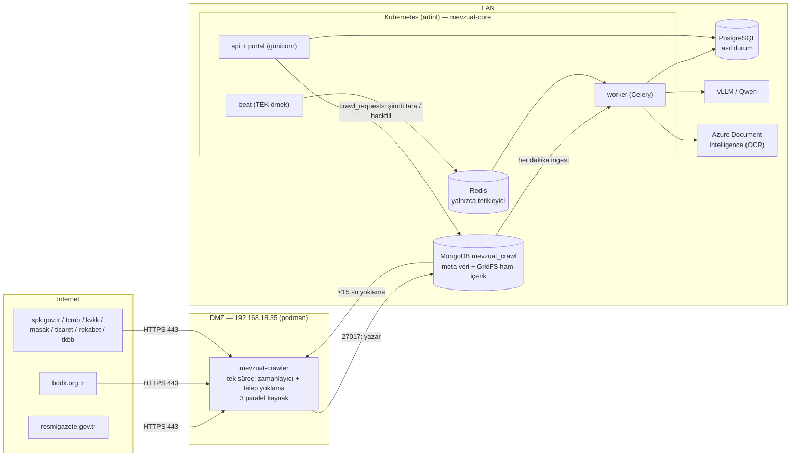

# 01 — Genel Bakış

## 1. Sistem ne yapıyor? (2 dakikalık anlatım)

Mevzuat ve Uyum Başkanlığı, bankayı etkileyen yeni düzenlemeleri dokuz resmî kaynaktan elle takip ediyordu
(Resmî Gazete, BDDK, SPK, TCMB, KVKK, MASAK, Ticaret Bakanlığı, Rekabet Kurumu, TKBB). Sistem bu işi şöyle
otomatikleştirir:

1. **Topla (İK-1):** Crawler kaynak sitelerini belirli saatlerde tarar, yeni veya değişmiş içeriği indirir ve
   sürümleyerek arşivler. Ham içerik hiç silinmez.
2. **İşle (İK-2):** HTML, PDF, DOCX ve gerekirse OCR ile metin çıkarılır. Aynı düzenlemenin farklı kaynaklardaki
   kopyaları (ör. BDDK sitesi ve Resmî Gazete) tek bir "düzenleme kaydında" birleştirilir.
3. **Analiz et (İK-3..5):** Kurum içi LLM (vLLM/Qwen) şu adımları uygular: bankayla ilgili mi (ilgililik + güven),
   ne kadar önemli (önem derecesi), kaynağa dayalı özet ve yürürlük tarihi, hangi birimleri ilgilendiriyor (birim
   önerisi).
4. **Sun (İK-6):** Portal, ilgili kayıtları uzman onayına sunar. Onay/red denetim izine yazılır, düzeltmeler
   örnek havuzuna geri beslenir.
5. **İzle (İK-7):** Kaynak sessizliği, hacim anomalisi, sayfa yapısı değişikliği, crawler'ın durması ve aktarım
   gecikmesi için alarm üretilir.

## 2. Topoloji: neden iki servis?

Kurum ağında internete yalnızca **DMZ**'deki sunucu (192.168.18.35, RHEL, podman) çıkabilir. DMZ'den LAN'a açık
tek kapı **MongoDB (27017)**'dir. LAN'daki ana servis internete çıkamaz. Bu kısıt mimarinin tamamını belirler:



| Bileşen | Nerede | Görev | Ölçek |
|---|---|---|---|
| `mevzuat-crawler` | DMZ (podman Quadlet) veya internete çıkabilen cluster (Helm) | Tarama, sürümleme, Mongo'ya yazma | **Tek örnek**, aynı anda 3 kaynak |
| MongoDB `mevzuat_crawl` | LAN, 10.155.7.195 | DMZ ↔ LAN teslim alanı | Kurum Mongo'su |
| `mevzuat-core` (api) | K8s | Portal + `/api/v1` | 2 replika (UAT values) |
| `mevzuat-core-worker` | K8s | Celery: ingest, process, ai, monitor kuyrukları | Başlangıçta 1 replika |
| `mevzuat-core-beat` | K8s | Celery zamanlayıcısı | **Tek örnek** |
| PostgreSQL | LAN | Tüm iş durumu (düzenlemeler, YZ çıktıları, denetim izi, alarmlar) | — |
| Redis | LAN | Celery broker'ı; kalıcılık gerekmez | — |

**Önemli tasarım ilkesi:** Redis yalnızca tetikleyicidir. Asıl durum PostgreSQL'deki durum makinesindedir
(`FETCHED/EXTRACTED/LINKED`, `NEW/RELEVANT/...`). Beat'in "bekleyenleri işle" görevleri güvenlik ağıdır. Redis
boşalsa bile iş kaybolmaz (`mevzuat-core/app/app/worker.py` başlık yorumu).

## 3. Depo haritası

Bu depo kurumdaki birden fazla reponun birebir karşılığıdır (`README.md`):

```
mevzuat-core/            → kurum "mevzuat-core" reposu (LAN, K8s)
  app/app/collectors/    ← ORTAK: toplama katmanı (kaynak burası, crawler'a kopyalanır)
  app/app/crawler/       ← ORTAK: DMZ crawler servisi
  app/app/ingest.py      Mongo → PostgreSQL aktarımı
  app/app/processing/    metin çıkarma, OCR, tekilleştirme
  app/app/ai/            ilgililik, önem, özet, birim eşleştirme, LLM istemcisi
  app/app/monitoring/    sağlık kontrolleri, alarmlar, backfill/reprocess
  app/app/api/           FastAPI uygulaması
  app/app/tasks/         Celery görevleri; app/app/worker.py: Beat zamanlaması
  portal/                tek dosya portal arayüzü + süreç haritası (/surec)
mevzuat-crawler/         → kurum "mevzuat-crawler" reposu (DMZ)
  app/                   yalnızca toplama + crawler (LLM/OCR/API/Celery yok)
  deploy/dmz/            Quadlet, compose, crawler.env örneği
ai-uat-charts/           → kurum chart reposu (Helm)
tools/shared.py          core ↔ crawler ortak dosya eşitleme/denetim
docker-compose.yml       yerel uçtan uca ortam
jupyterhub/start.sh      JupyterHub geliştirme sunucusunda iki servisi yerel süreç olarak çalıştırır
```

### Ortak kod kuralı (çok önemli)

`settings.py`, `db.py`, `storage.py`, `mongo.py`, `collectors/`, `crawler/`, `config/sources.yaml`, `config/certs/`
ve ortak testler/fixture'lar **iki serviste de** bulunur, çünkü servisler ayrı repolara gider. **Kaynak
`mevzuat-core`'dur:**

```bash
# 1) Değişikliği mevzuat-core/app/... altında yapın
python tools/shared.py sync     # 2) core → crawler kopyala
python tools/shared.py check    # 3) fark varsa 1 ile çıkar (make test içinde de çalışır)
```

Crawler dizinindeki ortak dosyayı doğrudan düzenlerseniz `check` hata verir ve bir sonraki `sync` değişikliğinizi
siler. Bu rehberdeki dosya yolları crawler dizinini gösterir (`mevzuat-crawler/app/app/...`), çünkü DMZ'de çalışan
kopya odur. İçerik core'dakiyle aynıdır.

## 4. Veri yolu tek cümleyle

> Crawler, `sources.yaml`'daki cron'a göre bir kaynağın liste sayfalarını okur. Liste satırı değişmiş öğelerin
> detayını ve eklerini indirir, içerik hash'i değiştiyse yeni sürüm olarak Mongo'ya (`raw_documents` + GridFS)
> yazar. Core her dakika `synced=false` kayıtları PostgreSQL'e alır, metni çıkarır, düzenleme kaydına bağlar,
> yeni kayıtları YZ hattına sokar. İlgili bulunanlar portalda uzman onayına düşer.

## 5. Sözlük

| Terim | Anlamı | Nerede |
|---|---|---|
| **Kaynak (source)** | İzlenen kurum sitesi (9 adet) | `config/sources.yaml` → `sources[]` |
| **Kanal (channel)** | Bir kaynağın tek bir listesi/beslemesi + onu okuyan strateji (ör. BDDK "kurul_kararlari") | `sources[].channels[]` |
| **Strateji** | Listeyi öğelere çeviren yöntem: `feed`, `css_list`, `link_pattern`, `json_api`, `wordpress_api`, `resmi_gazete` | `collectors/strategies/` |
| **ItemRef** | Liste sayfasında görülen tek öğe (başlık, URL, tarih, kimlik) | `collectors/base.py` |
| **external_id** | Öğenin kaynak içindeki kararlı kimliği (URL'den/ID'den türetilir) | strateji `id_pattern` |
| **listing_hash** | Liste satırının özeti: `sha1(başlık\|tarih\|version_key\|url)` | `ItemRef.listing_hash()` |
| **version_key** | Kaynağın verdiği değişiklik işareti (WP `modified`, TCMB `CACHEID`, Atom `updated`) | strateji |
| **Sürüm (version)** | Aynı `external_id` için içerik hash'i değiştikçe artan numara; eski sürüm `is_latest=false` kalır | `runner._store_items` |
| **BASELINE** | Bir kanalın ilk taramasında sitede zaten duran içerik; arşivlenir ama "yeni düzenleme" sayılmaz, YZ'ye gitmez | `runner.py` başlık yorumu |
| **fetch_run** | Bir kaynağın bir tarama çalıştırması ve istatistikleri | Mongo `fetch_runs` / PG `fetch_run` |
| **raw_document** | Arşivlenmiş ham belge sürümü (`role`: main / attachment / listing) | Mongo `raw_documents` / PG `raw_document` |
| **regulation** | Tekilleştirilmiş düzenleme kaydı (portaldaki kayıt) | PG `regulation` |
| **crawl_request** | LAN'dan crawler'a bırakılan "şimdi tara" / "backfill" talebi | Mongo `crawl_requests` |
| **İK-1..8** | Kapsam formundaki iş kalemleri: 1 toplama, 2 işleme/tekilleştirme, 3 tespit/önem, 4 özet, 5 birim, 6 portal, 7 izleme, 8 test/devreye alma | `backend-gelistirme-plani.md` §6 |
| **CRAWL_MODE** | `remote`: kurum (DMZ crawler + ingest). `local`: tek kutu/geliştirme (Celery `collect` kuyruğu tarar) | `settings.py` |

## 6. Teknoloji yığını

| Katman | Crawler | Core |
|---|---|---|
| Dil | Python 3.12 (imaj), ≥3.11 | Python 3.12 |
| HTTP | `httpx`, `curl_cffi` (tarayıcı TLS parmak izi). Playwright desteği kodda var ama imajda kurulu değil ve hiçbir kaynak kullanmıyor | `httpx` (OCR/webhook) |
| Ayrıştırma | `selectolax` (HTML), `feedparser` (RSS/Atom) | `trafilatura` veya kanal seçicisi (HTML), `pymupdf` (PDF), `python-docx`, `rapidfuzz` (benzerlik) |
| YZ | — | `openai` istemcisi (OpenAI veya OpenAI uyumlu vLLM), `jinja2` sürümlü prompt şablonları |
| API | — | FastAPI + gunicorn/UvicornWorker, `pyjwt` (Keycloak RS256) |
| Zamanlama | `croniter` (kendi döngüsü) | Celery Beat |
| Veri | `pymongo` + GridFS | SQLAlchemy + Alembic (PostgreSQL), `pymongo` (ingest) |
| Konfigürasyon | `pydantic-settings` (ortam değişkeni / `.env`), `sources.yaml` (pydantic şeması) | aynı + `taxonomy.yaml`, `units.yaml` |
| Dağıtım | Podman Quadlet (DMZ) / Helm | Helm + ArgoCD, Jenkins → Nexus |

Sıradaki bölüm: [02 — Crawler mimarisi](02-crawler-mimarisi.md)
