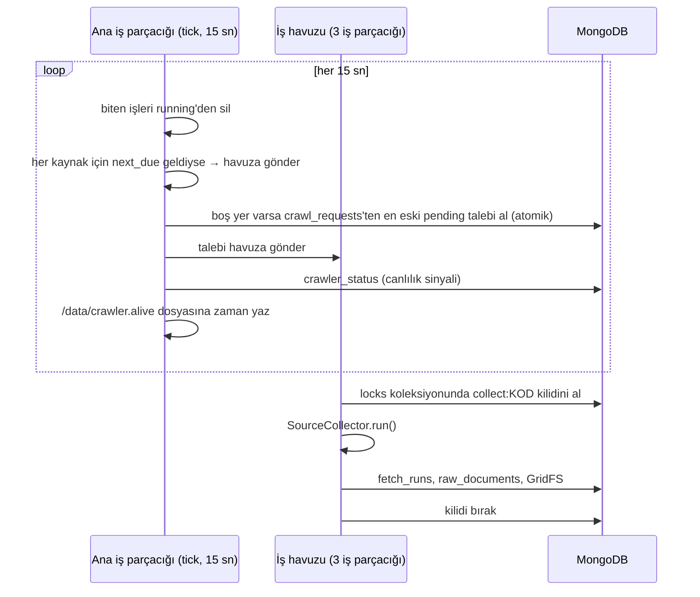
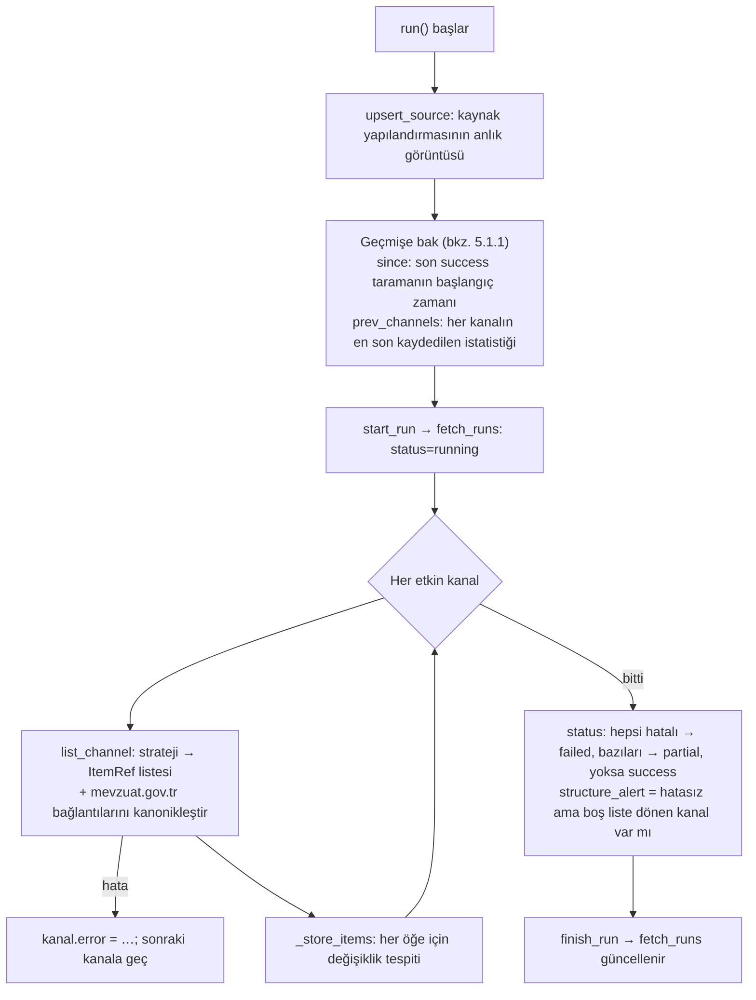

# 02 — Crawler Mimarisi (derinlemesine)

Bu bölüm `mevzuat-crawler/app/app/` altındaki kodun nasıl çalıştığını anlatır. Okurken dosyaları yan yana açın.
Kod okuma sırası da bu bölümün sırasıdır:

```
crawler/cli.py          → giriş noktası (serve / run / backfill / check / healthcheck)
crawler/service.py      → CrawlerService: döngü, zamanlama, talepler, kilit, canlılık
collectors/runner.py    → SourceCollector: bir kaynağın uçtan uca taranması (asıl iş burada)
collectors/strategies/  → liste sayfasını ItemRef'lere çeviren 6 strateji
collectors/http.py      → Fetcher: istemci seçimi, izin listesi, hız sınırı, yeniden deneme
collectors/tls.py       → eksik TLS ara sertifikası çözümü
collectors/resolvers.py → mevzuat.gov.tr bağlantılarının kanonik hale getirilmesi
crawler/mongo_store.py  → MongoCrawlStore: Mongo/GridFS'e yazım
mongo.py, storage.py    → koleksiyonlar, indeksler, talepler, kilitler, GridFS
collectors/config.py    → sources.yaml şeması (pydantic)
```

---

## 1. Süreç modeli: neden tek süreç?

`mevzuat-crawler serve` (imajın varsayılan komutu) **tek bir Python süreci** başlatır:

- **Ana iş parçacığı:** `CrawlerService.serve()` her `CRAWLER_POLL_S` (varsayılan **15 sn**) saniyede bir `tick()`
  çalıştırır.
- **İş havuzu:** `ThreadPoolExecutor(CRAWLER_MAX_PARALLEL)` (varsayılan **3**). Her kaynak taraması bu havuzda bir
  iş parçacığında koşar.

Neden Celery değil? DMZ'den Redis'e ve PostgreSQL'e erişim yoktur, yalnızca MongoDB açıktır. Neden gunicorn
yok? Crawler web sunucusu değildir. Birden çok worker açılırsa zamanlayıcı da çoğalır ve aynı kaynak birkaç kez
taranır. Aynı sebeple Helm chart'ında `replicas: 1` ve `strategy: Recreate` sabittir
(`ai-uat-charts/mevzuat-crawler/templates/crawler.yaml`). **Crawler'ı asla iki örnek çalıştırmayın.** Ne DMZ'de
iki konteyner, ne de DMZ'ye ek olarak cluster'da bir kopya.



## 2. Zamanlama

Kaynak başına zamanlama `config/sources.yaml` içindeki `schedule` listesindeki **cron ifadeleridir**
(**Europe/Istanbul** saatiyle). Hesap `service.next_fire()` içinde `croniter` ile yapılır. Bir kaynağın birden
fazla ifadesi varsa en yakın tetikleme alınır.

`tick()` mantığı (`crawler/service.py`):

1. İlk turda her kaynak için `next_due[kod] = next_fire(şimdi)` hesaplanır. **İlk turda zamanlanmış tarama
   başlatılmaz.** Bekleyen LAN talepleri ise ilk turda alınabilir.
2. Sonraki turlarda `next_due <= şimdi` ise:
   - kaynak zaten çalışıyorsa (`running` sözlüğünde) bu tetikleme **atlanır** ("önceki tarama sürüyor"),
   - değilse havuza gönderilir.
   - Her iki durumda `next_due` bir sonraki cron anına ilerletilir.
3. Zamanlanmış işler `CRAWLER_MAX_PARALLEL`'e bakılmadan havuza gönderilir. Havuz dolu ise havuzun kuyruğunda
   bekler, kaybolmaz. LAN talepleri ise yalnızca `len(running) < max_parallel` iken alınır.

**Sonuçlar:**

- Tetikleme hassasiyeti en fazla ~15 sn kayar (yoklama aralığı).
- **Kaçan tetiklemeler telafi edilmez.** Servis 09:00'da kapalıysa 09:00 taraması yapılmaz, bir sonraki cron
  anı beklenir. Bu bilinçli bir karardır: liste sayfaları güncel içeriği gösterdiği için bir sonraki tarama kaçanı
  toplar. Resmî Gazete'de `lookback_days: 1` ile bugün + dün taranır. Daha uzun kesintide `backfill` gerekir (05 §6).
- Servis yeniden başlatılınca zamanlama sıfırdan hesaplanır, durum diskte tutulmaz.

Kaynak başına takvim tablosu ve "en geç ne zaman yakalanır" analizi: [03 — Tarama takvimi](03-tarama-takvimi-ve-kaynaklar.md).

## 3. Eşzamanlılık ve kilitler

Aynı kaynağın aynı anda iki kez taranmasını iki katman engeller:

| Katman | Nerede | Kapsam |
|---|---|---|
| Süreç içi takip | `CrawlerService.running` (kaynak kodu → Future) | Aynı süreçteki zamanlama + talepler |
| Mongo kilidi | `locks` koleksiyonu, `_id = "collect:<KOD>"` (`mongo.acquire_lock`) | Süreçler arası: ör. servis çalışırken elle `mevzuat-crawler run` |

Mongo kilidinin çalışma biçimi: `update_one({_id, expires_at < şimdi}, $set{owner, expires_at: şimdi+TTL},
upsert=True)`. Kilit başkasındaysa ve süresi dolmamışsa filtre eşleşmez, upsert aynı `_id` ile eklemeye çalışır ve
`DuplicateKeyError` alınır. Bu durumda `SourceBusy` fırlatılır ve tarama atlanır. TTL `CRAWLER_LOCK_TTL_S`
(varsayılan **3600 sn**). Çöken bir sürecin kilidi en geç 1 saat sonra devralınır. Kilit tarama boyunca
**yenilenmez**; bkz. [06 — Geliştirme noktaları](06-gelistirme-noktalari.md).

`CRAWL_MODE=local` (yerel/tek kutu) kurulumunda aynı amaçla `collectors/locks.py` kullanılır: Redis varsa Redis
kilidi, yoksa `fcntl` dosya kilidi.

## 4. LAN ile iletişim: tarama talepleri ve canlılık

LAN, DMZ'ye doğrudan bağlanamaz. Bu yüzden iletişim **Mongo üzerinden posta kutusu** biçimindedir.

### 4.1 `crawl_requests` yaşam döngüsü

```
core API / mevzuat-monitor            crawler tick()                      crawler iş parçacığı
──────────────────────────            ──────────────                      ────────────────────
insert {kind, source_code,     →  find_one_and_update                →  run_source / run_backfill
        params, status:pending}     {status:pending, kaynak meşgul değil}    ↓
                                    → status:running, claimed_by=host    finish_crawl_request
                                    (en eski önce: created_at artan)     → status: done | failed,
                                                                           result / error
```

- `kind=run`: "şimdi tara", yani admin API `POST /api/v1/admin/sources/{code}/run`. Portal arayüzünde henüz
  düğmesi yok; API (`/docs`) veya `curl` ile çağrılır. API talebi boş `params` ile bırakır (tüm kanallar,
  `max_details=200`). `channels`/`max_details` yalnızca talep belgesine elle yazılırsa kullanılır.
- `kind=backfill`: `POST /api/v1/admin/sources/{code}/backfill` (başlangıç–bitiş farkı ≤62 gün, yani 63 takvim
  gününe kadar) veya `mevzuat-monitor backfill` (CLI'da sınır yok). Resmî Gazete'de gün gün tarar, diğer kaynaklarda normal tarama yapar
  (`monitoring/reprocess.py:backfill`).
- Talep **en geç bir yoklama aralığında (≤15 sn)** alınır, kaynak meşgul değilse ve havuzda yer varsa.
- Tanımsız veya kapalı kaynak için talep hemen `failed` olur.
- Servis açılırken `requeue_orphaned_requests` **aynı host adına** ait yarım kalmış (`running`) talepleri
  `pending`'e geri alır.
- Sonuç (yeni belgeler) LAN'a ayrı bir yoldan, normal ingest ile ulaşır.

### 4.2 Canlılık

| Sinyal | Yazan | Okuyan | Eşik |
|---|---|---|---|
| Mongo `crawler_status` (`_id` = host adı, `at`, `running`, `next_due`, `sources`) | Her `tick()` | Core izleme (`monitoring/crawler.py`) | Son sinyal > `CRAWLER_STALE_MINUTES` (**30 dk**) → `crawler_down` alarmı |
| `/data/crawler.alive` dosyası | Her `tick()` | `mevzuat-crawler healthcheck` (podman/Docker HEALTHCHECK, 60 sn'de bir) | Dosya `max(4 × POLL_S, 120)` = **120 sn**'den eskiyse sağlıksız → Quadlet `HealthOnFailure=kill` → systemd `Restart=always` |

`next_due` alanı sayesinde Mongo'dan "her kaynağın bir sonraki tarama zamanı" okunabilir (05 §4).

## 5. Bir taramanın anatomisi: `SourceCollector.run()`

Asıl iş `collectors/runner.py` içindedir. Aynı sınıf iki yerde kullanılır:

- DMZ crawler: `MongoCrawlStore` ile (Mongo + GridFS).
- Yerel/test: `SqlCrawlStore` ile (SQLite/PostgreSQL + dosya sistemi).

Kayıt katmanı `CrawlStore` protokolüyle soyutlanmıştır (`collectors/store.py`).

### 5.1 Akış



#### 5.1.1 Taramadan önce geçmişe bakış: `since` ve `prev_channels`

Yeni tarama başlamadan önce `run()`, aynı kaynağın önceki taramalarına (`fetch_runs`) iki soru sorar:

**`since`: "En son ne zaman tam başarılı tarandım?"** (`store.last_success`)

- Yalnızca `status == "success"` olan en son taramanın `started_at` değeridir. `partial` ve `failed` sayılmaz,
  çünkü o taramalarda bazı kanallar hiç okunamamıştır.
- Hiç başarılı tarama yoksa `None` olur.
- `list_channel` üzerinden stratejiye (`ctx.since`) geçirilir. Bugün yalnızca `wordpress_api` stratejisi kullanır:
  API'den yalnızca `since - overlap_hours` (varsayılan 6 saat) sonrasını ister. `since` yoksa `lookback_days` kadar
  geriye gider. Diğer stratejiler `since`'i yok sayar ve her seferinde listeyi baştan okur.

**`prev_channels`: "Her kanal en son nasıldı?"** (`store.previous_channel_stats`)

Her tarama bitince `finish_run`, kanal başına bir `ChannelReport` özetini `fetch_runs.channels` alanına yazar:

```json
{ "kurul-kararlari": { "items": 412, "signature": "a1b2…", "baseline_complete": true, "deferred": 0, "error": null, … },
  "duyurular":       { … } }
```

`previous_channel_stats` bu kayıtlardan bir sözlük kurar:

1. Kaynağın `status` değeri `success` veya `partial` olan taramaları yeniden eskiye okunur (en fazla
   `CHANNEL_STATS_MAX_RUNS` = 1000). (`partial` da dahildir, çünkü o taramada başarılı olan kanalların istatistiği
   geçerlidir.)
2. `merge_channel_stats` bunları sırayla gezer ve her kanal adı için **ilk gördüğü, yani en yeni** kaydı alır.
   Sonuç `{kanal_adı: o kanalın en son istatistiği}` olur. `run()` bu taramada çalışacak kanalların adlarını
   verir; hepsi bulununca okuma durur. Normal durumda ilk kayıtta durulur.

Neden tek bir tarama değil? Her tarama her kanalı kapsamayabilir: `run(channels=[...])` ile yalnızca bazı
kanallar taranabilir veya bir kanal `enabled: false` yapılmış olabilir. En son tarama bir kanalı içermiyorsa, o
kanalın bilgisi daha eski bir taramadan alınır.

`run()` her kanal için bu sözlükten (`prev`) yalnızca iki alan okur:

| Alan | Ne için | Yoksa |
|---|---|---|
| `baseline_complete` | Kanal hâlâ baseline modunda mı? (§5.4) | `False` → kanal baseline modunda başlar |
| `signature` | Liste sayfasının HTML yapısı değişti mi? Önceki ve şimdiki imza farklıysa `structure_changed=True` | Karşılaştırma yapılmaz |

Dikkat edilecek iki durum:

- **Uzun süre görülmeyen kanal:** Kanal kapalı kalıp yeniden açıldığında önceki durumu (son 1000 tarama içinde)
  bulunur; baseline'ı tamamlanmışsa yeniden baseline'a girmez. Arada yayımlanıp o taramada ilk kez görülen öğeler
  yeni sayılır ve YZ'ye gider. Yalnızca 1000 taramadan eski kanallar ve hiç taranmamış kanallar baseline ile başlar.
- **Hatalı kanalın kaydı:** Liste hatası alan bir kanalın özeti de yazılır. `baseline_complete` önceki değerden
  taşınır, `signature` boş (`""`) kalır. `merge_channel_stats` boş imzayı atlayıp son 50 tarama içindeki boş olmayan
  en son imzayı kullanır; böylece hata (veya boş liste) sonrası taramada yapı karşılaştırması atlanmaz.

Önemli kurallar (`runner.py` başlık yorumu):

- **Kanal izolasyonu:** Bir kanaldaki liste hatası diğerlerini durdurmaz. Tarama `partial` olur.
- **Detay hataları kanal hatası değildir:** Bir öğenin detayı `FetchError` ile indirilemezse `warnings`'e yazılır
  ve öğe kaydedilmez. Bir sonraki taramada yeniden denenir. Tüm detaylar başarısız olsa bile tarama `success`
  olabilir. **Dikkat:** Yalnızca `FetchError` yakalanır. `_store_items` try bloğunun dışındadır. Başka bir istisna
  (sarmalanmamış bir httpx hatası, Mongo hatası) taramayı yarıda keser: sonraki kanallar taranmaz, `finish_run`
  çağrılmaz, `fetch_runs` kaydı `running` kalır.
- **Ham içerik asla silinmez.**

### 5.2 Detay bütçesi (`max_details`)

Bir taramada en fazla `max_details` (varsayılan **200**) detay indirilir. Bu sayıya `refresh` kontrolleri de
dahildir ve bütçe **kanallar arasında paylaşılır** (sıra `sources.yaml`'daki kanal sırasıdır). Bütçe bitince kalan
yeni/değişmiş öğeler `deferred` sayılır ve bir sonraki taramaya kalır. Bu durum en çok ilk kurulumda görülür:
BDDK kurul kararları listelerinde 400+ öğe vardır, birikim birkaç taramada erir.

### 5.3 Değişiklik tespiti: iki katman

Her öğe için `_store_items` şu karar tablosunu uygular. `prev` aynı `external_id`'nin en son sürümüdür
(`is_latest=True`, ek olmayan):

| Durum | Ne olur | Sayaç |
|---|---|---|
| `prev` var, `listing_hash` aynı, yenileme zamanı gelmemiş (veya yenileme/detay bütçesi yok) | **Detay istenmez.** Hiçbir şey yazılmaz | `unchanged` |
| `prev` var, `listing_hash` aynı, `refresh_after_days` doldu (bütçe varsa) | Detay yeniden indirilir, hash karşılaştırılır | `refreshed` (+ ardından `unchanged` veya `changed`; aynı öğe iki sayaçta görünür) |
| Detay gerekiyor ama bütçe bitti | Atlanır | `deferred` |
| Detay indirildi, içerik `sha256` aynı | `touch_unchanged`: `listing_hash`, `version_key`, `title`, `extra.checked_at` güncellenir. Yeni sürüm yok | `unchanged` |
| Detay indirildi, `sha256` farklı, `prev` var | **Yeni sürüm** (`version+1`). Eski sürüm `is_latest=False` | `changed` |
| `prev` yok | Sürüm 1 | `new` |

- **Katman 1, `listing_hash`:** `sha1(başlık | yayım tarihi | version_key | url)`. Liste satırında görünen bir şey
  değişmedikçe detay sayfasına gidilmez. Taramaların ucuz olmasının sebebi budur: değişiklik yoksa yalnızca liste
  sayfaları istenir.
- **Katman 2, içerik `sha256`:** Satır değişse bile içerik aynıysa sürüm açılmaz.
- Ham içerik GridFS'e **içerik adresli** yazılır (`raw/<ilk2>/<sha256>`). Aynı içerik iki kez saklanmaz.
- Ekler (`role=attachment`), ana belgenin sürüm numarasını alır. `external_id`'leri `"<ana_id>#<sha256[:12]>"`
  olur, `parent_id` ana belgeyi gösterir.
- Mongo'da yazım sırası bilinçlidir: **önce yeni sürüm eklenir, sonra eskisinin `is_latest`'i düşürülür.** İkisinin
  arasında çökme olursa belge kaybolmaz. İki "latest" oluşabilir; `latest_documents` sürüme göre artan sıraladığı
  için büyük sürüm kazanır.

### 5.4 BASELINE (ilk tarama kuralı)

Sorun: Sistem ilk kez açıldığında BDDK sitesinde yıllardır duran yüzlerce karar "yeni" görünür. Bunların YZ'ye
gönderilip portala düşmesi istenmez.

Çözüm (`runner.py`):

- Kanalın önceki istatistiklerinde `baseline_complete=True` yoksa kanal **baseline modundadır**.
- Bu moddayken ilk kez görülen (`prev is None`) öğeler ve ekleri `is_baseline=True` ile arşivlenir.
- Kanal, **ertelenen öğe kalmadan** bir taramayı bitirdiğinde (`deferred == 0`) `baseline_complete=True` olur.
  Bayrak `fetch_runs.channels.<kanal>.baseline_complete` içinde taşınır.
- Core tarafında baseline belgeler metin çıkarma ve tekilleştirmeden geçer. Sonradan yayımlanan bir kopya
  eşleşebilsin diye bu gereklidir. Oluşan düzenleme `processing_status=BASELINE` olur ve **YZ'ye gitmez.** Varsayılan
  olarak OCR'a da gönderilmez (`OCR_BASELINE=false`).
- Kanal bazlıdır: `sources.yaml`'a sonradan eklenen yeni bir kanal, kendi ilk taramasında yine baseline modunda
  başlar.

Bilinçli yeniden işleme: `reprocess --stage classify`, BASELINE kayıtları `NEW`'e çekerek YZ'den geçirebilir
(`monitoring/reprocess.py`).

### 5.5 Yerinde güncellenen metinler: `refresh_after_days`

Bazı kaynaklar konsolide metni aynı adreste günceller ama liste satırında bunu gösteren bir tarih/sürüm alanı
yoktur (mevzuat.gov.tr, SPK Mevzuat Sistemi). Bu kanallarda liste satırı aynı kalsa da her öğe en az
`refresh_after_days` günde bir yeniden indirilir ve hash karşılaştırılır. Yük yaymak için tarama başına en fazla
`refresh_max_per_run` (varsayılan **20**) öğe yenilenir. Son kontrol zamanı `extra.checked_at` alanında tutulur.

Kullanan kanallar: BDDK `duzenlemeler`, SPK `mevzuat`, Ticaret `tuketici_mevzuati` (hepsi 14 gün).

### 5.6 Detay indirme kuralları (`fetch_documents`)

| Durum | Saklanan |
|---|---|
| Kanalda `fetch_detail: false` **veya** bağlantı kaynağın `allowed_hosts` listesi dışında (ör. KVKK → resmigazete.gov.tr PDF'i) | Detay istenmez. Liste satırının JSON anlık görüntüsü `role=listing`, `application/json` olarak saklanır. İçeriği RG kaynağı getirir, core tekilleştirmesi birleştirir |
| Strateji içeriği zaten getirdiyse (`inline_content`: MASAK WordPress API) | Detay isteği atılmaz, içerik doğrudan saklanır |
| Bağlantı mevzuat.gov.tr'ye gidiyorsa | `resolvers.resolve()` kanonik kimlik (`mevzuat.gov.tr:<tür>.<tertip>.<no>`), kamuya açık URL ve **iframe içerik adresi** üretir. Tam metin iframe adresinden indirilir |
| Kanalda `attachment_pattern` var ve ana belge HTML | Detay sayfasındaki desene uyan bağlantılar (en fazla `COLLECT_MAX_ATTACHMENTS` = **5**) indirilir. İzin listesi dışındaki ek atlanır. İndirilemeyen ek yalnızca loglanır |

`_normalize_external` liste aşamasında aynı mevzuat.gov.tr belgesine farklı biçimlerde (eski `Metin.Aspx?MevzuatKod=`,
yeni `?MevzuatNo=…`, http/https, www) verilen bağlantıları tek kimliğe indirger ve kanal içinde tekilleştirir.

### 5.7 Sessiz bozulmanın erken sinyalleri

Uyum açısından en riskli durum, sitenin açılması ama içeriğin gelmemesidir. Crawler her kanal için şu sinyalleri
üretir, core izlemesi bunları alarma çevirir (04 §6):

| Sinyal | Hesap | Anlamı |
|---|---|---|
| `signature` | Öğe kapsayıcılarının etiket/sınıf yolunun hash'i (`_html.node_signature`). Feed'de sürüm+alan adları, JSON'da anahtar kümesi | Önceki taramadan farklıysa `structure_changed=True` (erken uyarı) |
| `empty_listing` | Öğe sayısı < `expected.min_items_per_run` (varsayılan 1; MASAK 0) | Sayfa 200 döndü ama öğe yok → yapı değişmiş olabilir |
| `structure_alert` (tarama düzeyi) | Hatasız ama boş liste dönen kanal var mı | |
| `warnings` | Ör. RG "asıl sayı fihristi boş (henüz yayımlanmamış olabilir)" | |

## 6. HTTP katmanı (`collectors/http.py`)

### 6.1 İstemci türleri (`sources.yaml` → `client`)

| İstemci | Kütüphane | Kullanan | Neden |
|---|---|---|---|
| `httpx` (varsayılan) | httpx | SPK, TCMB, KVKK, MASAK, Rekabet, TKBB, HMB, GİB, KGK | Standart |
| `impersonate` | `curl_cffi` (Chrome TLS parmak izi) | **Resmî Gazete, BDDK, Ticaret** | Bu siteler tarayıcı olmayan istemcileri TLS el sıkışma imzasından tanıyıp engelliyor |
| `browser` | Playwright/Chromium | Hiçbiri | Yalnızca JS ile render edilen ve API'si olmayan sayfalar için son çare. Bağımlılık imajda yok |

`impersonate` modunda User-Agent başlığı gönderilmez. curl_cffi tarayıcı başlıklarını kendisi üretir, aksi halde
parmak izi bozulur.

### 6.2 Her istekte uygulanan kurallar (`Fetcher.get` / `Fetcher.post_json`)

`post_json(url, veri)` yalnız POST kabul eden JSON API'ler içindir (GİB `/api/gibportal/…` GET'e 405 döner). Gövde
kanonik JSON'dur (`json_body`: anahtarlar sıralı, boşluksuz); aşağıdaki kuralların hepsi POST'ta da aynen geçerlidir.
`browser` istemcisi POST desteklemez.

1. **Host izin listesi:** İstenen URL'nin host'u `allowed_hosts`'ta (fnmatch desenleri, `base_url` host'u otomatik
   eklenir) değilse `HostNotAllowed`. Yanlış yapılandırılmış bir desenin crawler'ı rastgele sitelere götürmesini
   engeller. **Sınır:** Yönlendirmeler (3xx) istemci tarafından izlenir ve izin listesine tabi değildir; yalnızca
   istenen URL denetlenir.
2. **Kibar tarama:** Aynı host'a ardışık istekler arasında en az `request_delay_s` (kaynakta tanımlıysa, ör. RG
   **3 sn**), yoksa `COLLECT_REQUEST_DELAY_S` (**1,5 sn**) beklenir. Sayaç `Fetcher` nesnesi başınadır, yani
   kaynak taraması başına.
3. **Yeniden deneme:** HTTP **429/500/502/503/504** ve istemci hataları "geçici" sayılır: httpx'te
   `TimeoutException`, `NetworkError` (TLS doğrulama hatası `ConnectError` da dahil), `ProxyError`; curl_cffi'de tüm
   `RequestsError`. **Toplam 3 deneme**, aralarda üstel bekleme **2 sn, 4 sn** (tenacity: `multiplier=2, min=2,
   max=30`). Diğer 4xx/5xx hemen `FetchError`. Diğer httpx hataları (`RemoteProtocolError`, `TooManyRedirects`,
   `DecodingError` …) `FetchError`'a sarmalanmaz, olduğu gibi yükselir (bkz. §5.1 dikkat notu).
4. **Sınırlar:** Zaman aşımı `COLLECT_TIMEOUT_S` (**30 sn**). Yanıt boyutu `COLLECT_MAX_BYTES` (**50 MB**): yanıt
   tamamen belleğe alındıktan sonra reddedilir, indirme sınırı değildir.
5. **Kimlik:** `User-Agent: MevzuatTakipBot/1.0 (+Mevzuat ve Uyum Baskanligi)`, `Accept-Language: tr-TR,tr;q=0.9`.
6. **Karakter kodlaması:** Önce `Content-Type` charset'i, sonra `<meta charset>`, sonra UTF-8. Çözülemezse
   **windows-1254** (eski Türkçe sayfalar, ör. RG `.htm` dosyaları).
7. **Kayıt (Recorder):** `probe --record` ile her yanıt `manifest.json` + dosya olarak kaydedilir.
   `ReplayFetcher` testlerde bu kayıtları ağsız oynatır. Manifest anahtarı `request_key`'dir: GET'te URL'nin
   kendisi (eski fixture'lar geçerli), POST'ta `"POST <url> #<gövde sha1'inin ilk 12 hanesi>"`. Aynı adrese farklı
   gövdeyle (ör. GİB tebliğleri kanun başına) yapılan istekler ayrı kaydedilir.

### 6.3 Proxy ve TLS

- Proxy: `HTTPS_PROXY` ayarı, yoksa ortamdaki `HTTPS_PROXY`/`https_proxy`.
- Kök sertifika deposu: `CA_BUNDLE`, `REQUESTS_CA_BUNDLE`, `SSL_CERT_FILE`, `CURL_CA_BUNDLE` sırasıyla, yoksa
  certifi. İmajda `SSL_CERT_FILE=/etc/ssl/certs/mevzuat-bundle.pem` ayarlıdır (certifi + sistem deposu + kurum CA'ları).
- **Eksik ara sertifika sorunu:** BDDK ve (Türkiye'den bağlanıldığında) Resmî Gazete, mevzuat.gov.tr TLS
  el sıkışmasında ara sertifikayı göndermiyor. Tarayıcılar bunu AIA ile tamamlar, Python tamamlamaz. Çözüm:
  `config/certs/*.pem` altındaki ara sertifikalar kök depoyla birleştirilip `CA_CACHE_DIR` altında içerik hash'li
  bir paket üretilir (`build_ca_bundle`). Güven yine kök sertifikaya dayanır. Yeni bir site aynı hatayı verirse
  `mevzuat-collect ca-fetch HOST` sertifikayı AIA'dan indirir, **kök depoya karşı doğrular** ve yalnızca
  doğrulananı yazar (`collectors/tls.py`). `check-access` zincir hatasını tanır ve bu komutu önerir.

## 7. Strateji katmanı (`collectors/strategies/`)

Her kanalın `strategy` alanı bir sınıfa eşlenir (`strategies/__init__.py`). Strateji yalnızca **liste** üretir
(`ChannelResult`: öğeler, sayfa sayısı, imza, uyarılar). Detay indirme ortaktır (`runner.fetch_documents`).

| Strateji | Kullanıldığı yer | Nasıl çalışır | Kimlik (`external_id`) |
|---|---|---|---|
| `resmi_gazete` | RG `fihrist` | `/fihrist?tarih=YYYY-MM-DD[&mukerrer=N]`. Bugün + `lookback_days` (1) gün geri. Her gün için asıl sayı + mükerrer 1..4, **ilk boş mükerrerde durur**. Bölüm başlıkları (`.html-title`/`.html-subtitle`) kategori olur. "İLÂN BÖLÜMÜ" atlanır; yalnızca "Çeşitli İlânlar" dizini açılır ve ilan veren kurum adı `ilan_issuers` regex'lerine uyan ilanlar (BDDK, TCMB, SPK, MASAK, TMSF, KVKK, Rekabet, Ticaret, SEDDK, HMB, TKBB/TBB, Borsa/MKK/Takasbank) öğe olur. Gün sınırı İstanbul saatiyle hesaplanır | URL'den `20260925-1`, mükerrer `20260925M1-…`, ilan `20260925-4-25` |
| `link_pattern` | BDDK (7 kanal), TCMB mevzuat, Ticaret tüketici, Rekabet duyuru, TKBB | Sayfada (`scope` içinde) `href_pattern`'e uyan tüm bağlantılar. Başlık bağlantı metninden. Metin "İncele/Git" gibi anlamsızsa üst elemandan alınır. Tarih önce `date_selector` ile öğe kapsayıcısında, bulunamazsa `date_regex` ile kapsayıcı + en fazla 3 üst
  elemanda (≤600 karakter) aranır. `fields` ile ek alanlar (karar sayısı/tarihi), `group_selector` ile akordeon grubu, `version_pattern` ile sürüm anahtarı (TCMB `CACHEID`). `href_attrs` ile adres başka öznitelikten okunabilir (KGK mevzuat ağacı: `<a data-href=…>`). CSS sınıflarına bağlı olmadığı için şablon değişikliğine dayanıklıdır | `id_pattern` grubu, yoksa URL yolu+sorgusu |
| `css_list` | SPK bülten/basın, KVKK (3), Ticaret duyuru, Rekabet kararlar, KGK duyuru/son yayımlananlar | `item` seçicisi = öğe kapsayıcısı. İçinden `link`, `title`, `date`, `summary`, `fields`. `pagination` ile `?param=N` ek sayfalar (öğe gelmeyince durur) | `id_pattern` veya URL |
| `feed` | TCMB basın duyuruları | RSS/Atom (`feedparser`). Türkçe tarihler kendi ayrıştırıcımızla. Çift kaçışlı başlıklar çözülür, http→https. `version_key = updated` | `id_pattern` veya URL |
| `json_api` | SPK `mevzuat` (`mevzuat.spk.gov.tr/api/Search/All`), GİB (8 kanal, `gib.gov.tr/api/gibportal/…`) | React/Next.js ön yüzün kullandığı JSON uç noktası. Alan eşlemesi tamamen YAML'da (`{alan}` şablonları), `filter`, `version_fields`. `method: POST` + `body` (liste ise adres × gövde başına bir istek) ve `inline_html` (öğedeki HTML alanı içerik olarak saklanır; istemci tarafında oluşan SPA detay sayfası indirilmez, ekler bu HTML'den alınır) | Şablon: `{contentSource}-{contentID}`, GİB `ozelge-{id}` |
| `wordpress_api` | MASAK, HMB (`/portal/v2/` posts + pages) | WP REST API, **artımlı:** `modified_after = son başarılı tarama − 6 sa` (saate yuvarlanır). İlk taramada `lookback_days` (30) gün. 50'lik sayfalar, en fazla 3 sayfa/uç nokta. İçerik yanıtla gelir (detay isteği yok). İç host (`api-masak…`) kamuya açık adrese çevrilir (`public_link_rewrite`) ya da adres uç nokta başına şablondan üretilir (`public_url`, HMB `/duyuru/{slug}`). `query` uç nokta başına ek sorgu (HMB `categories_exclude`), `category_map` WP kategori kimliğini kategori adına çevirir | `posts:123` |

Ortak yardımcılar:

- `_urls.expand_urls`: `{year}` şablonu o yıla açılır. **1–15 Ocak'ta önceki yıl da** eklenir, yıl dönümünde
  Aralık sonu yayınları kaçmasın diye (SPK bülten/basın).
- `_html.parse_html`: `script/style/noscript/svg`, `nav/footer` ve kısa `header` atılır (Rekabet içeriği `header`
  içine koyduğu için uzun header korunur).
- `_html.inline_document`: API'den gelen HTML gövdeyi başlıklı tam belgeye sarar (`wordpress_api`, `json_api`).
- `dates.parse_tr_date`: "25 Eylül 2026 Cuma", "17 Eyl 2026", "18 EYL. 2026" (KGK), "24.9.2026", ISO, RFC 822.

## 8. MongoDB sözleşmesi (`mevzuat_crawl`)

| Koleksiyon | Crawler | Core | Not |
|---|---|---|---|
| `sources` | yazar (her taramada upsert) | okur, `synced` işaretler | `_id` = kaynak kodu, `config` = YAML anlık görüntüsü |
| `fetch_runs` | yazar | okur | `status: running → success \| partial \| failed`, `items_*`, `requests`, `channels{…}`, `errors`, `structure_alert` |
| `raw_documents` | yazar | okur | Sürüm başına bir belge; `role`, `is_latest`, `parent_id`, `is_baseline`, `storage_key` |
| `raw.files` / `raw.chunks` | yazar (yalnızca ekleme) | okur | GridFS kovası `raw`, dosya adı = `storage_key` |
| `crawl_requests` | alır, sonuçlandırır | ekler | 4.1 |
| `locks` | yazar/siler | — | 3 |
| `crawler_status` | yazar | okur | 4.2 |

**Senkron kuralı:** Crawler her yazımda `synced=false` yapar ve `rev`'i artırır (`mongo_store._set`). Core kaydı
PostgreSQL'e aktardıktan sonra `synced=true`'yu **yalnızca `rev` değişmemişse** koyar
(`update_one({_id, rev}, …)`). Arada güncellenen kayıt bir sonraki turda yeniden aktarılır. Aktarım `ext_id` (Mongo
`_id`) ile idempotent upsert'tür.

**İndeksler** (`mongo.ensure_indexes`, açılışta): `(source_code, external_id, version)` tekil,
`(source_code, external_id, is_latest)`, `synced=false` kısmi indeksleri, `fetch_runs(source_code, started_at)`,
`crawl_requests(status, created_at)`, `raw.files(filename, uploadDate)`.

**Yetki** (`mevzuat-core/deploy/mongo/init-users.js`): `mevzuat_crawler` yalnızca `mevzuat_crawl`'a yazar.
Belge **silemez**, GridFS'e yalnızca ekleyebilir, başka veritabanını göremez. DMZ ele geçirilse bile ham arşiv
silinemez (meta koleksiyonlarda `update` yetkisi vardır). `mevzuat_core` belge silemez ve ham içeriği (GridFS)
değiştiremez. Meta koleksiyonlarda `update` yetkisi vardır; yalnızca `synced` alanını yazması bir **kod
sözleşmesidir**, Mongo yetkisiyle zorlanmaz. Ayrıca talep ekler.

## 9. Hata durumlarında davranış

| Durum | Davranış | Nereden görülür |
|---|---|---|
| Bir kanalın liste sayfası hata verdi | Kanal `error`, diğer kanallar sürer. Hepsi hatalıysa `failed` | `fetch_runs.errors`; core `fetch_error` alarmı |
| Detay sayfası indirilemedi | Uyarı. Öğe yazılmaz, sonraki taramada yeniden denenir | `fetch_runs.channels.<k>.warnings` |
| 429/5xx/zaman aşımı | 3 deneme, sonra hata | log |
| İzin listesi dışı host | Liste URL'sinde `HostNotAllowed` (kanal hatası). Detayda istek atılmaz, liste anlık görüntüsü saklanır (§5.6). Ekte atlanır (info log) | log |
| MongoDB erişilemiyor | `tick()` hata loglar, döngü sürer. Canlılık dosyası güncellenmez ve ~2 dk'da bayatlar. 60 sn aralıklı 3 ardışık başarısız kontrolden sonra (≈4–5 dk) Quadlet/K8s konteyneri yeniden başlatır; compose'da `restart: always` sağlıksız konteyneri yeniden başlatmaz. Açılışta `ensure_indexes` başarısızsa süreç çıkar ve systemd yeniden başlatır | `journalctl -u mevzuat-crawler`; core `crawler_down` |
| Tarama sırasında süreç öldü | O ana kadar yazılan sürümler kalır (sonraki tarama onları "aynı" görür). `fetch_runs` kaydı `running`'de kalır. Kilit TTL dolana kadar (≤1 sa) kaynak "meşgul" görünebilir | 06 §1 |
| SIGTERM (durdurma/güncelleme) | Yeni iş alınmaz. Süren taramalar **ve havuz kuyruğunda bekleyen işler** çalıştırılıp beklenir (`shutdown(wait=True)`, `cancel_futures` yok). Süre sınırı: K8s `terminationGracePeriodSeconds: 150`, compose `stop_grace_period: 2m`. Quadlet'te `TimeoutStopSec=150` yalnızca systemd'nin sınırıdır; podman'ın kendi durdurma süresi (`StopTimeout=` verilmediği için varsayılan 10 sn olabilir) daha kısa olabilir, bkz. 06 §4. Süreyi aşan tarama öldürülür | log: "durduruluyor; süren taramalar bekleniyor" |

## 10. Komutlar (özet)

| Komut | Ne yapar |
|---|---|
| `mevzuat-crawler serve` | Servis (konteyner komutu) |
| `mevzuat-crawler check` | Mongo ping, indeksler, aktarılmayı bekleyen belge/tarama, bekleyen talep, son sinyal |
| `mevzuat-crawler run KOD\|all [--channel K] [--max-details N]` | Elle tarama (Mongo'ya yazar, kilide uyar) |
| `mevzuat-crawler backfill KOD --from … --to …` | Geçmiş dönem |
| `mevzuat-crawler healthcheck` | Canlılık dosyası taze mi (çıkış kodu) |
| `mevzuat-collect sources` | Kaynak/kanal listesi ve doğrulama tarihi |
| `mevzuat-collect check-access [KOD…]` | Ağ/proxy/TLS erişim testi |
| `mevzuat-collect probe KOD [--channel K] [--record DİZİN] [--with-details]` | Listeyi çeker, **yazmaz**. Kayıtla fixture üretir |
| `mevzuat-collect ca-fetch HOST…` | Eksik ara sertifikayı indirip doğrular |

Sıradaki bölüm: [03 — Tarama takvimi ve kaynaklar](03-tarama-takvimi-ve-kaynaklar.md)
