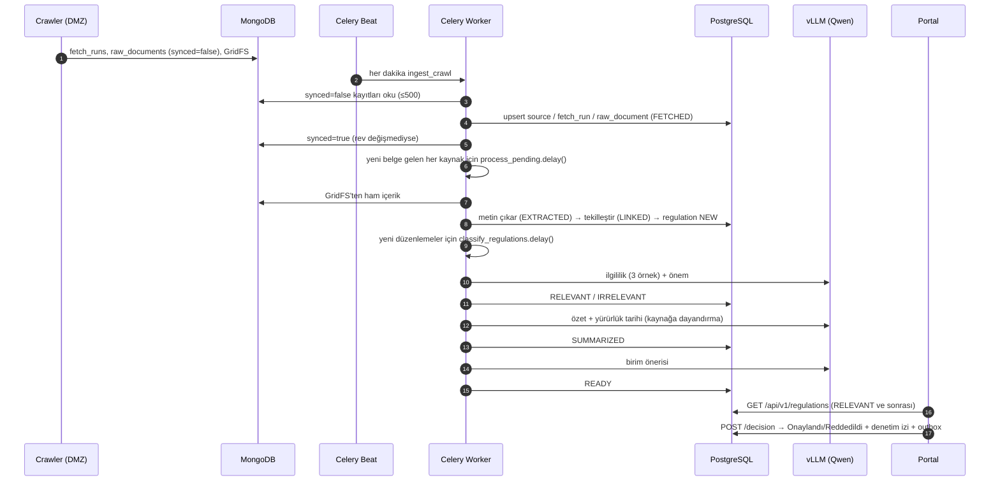
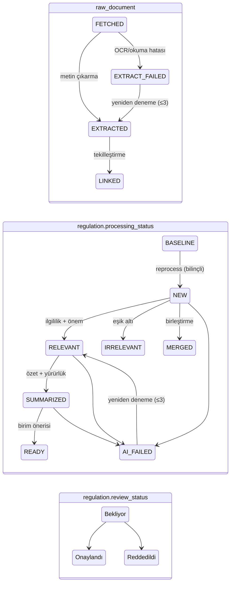

# 04 — Crawler Sonrası: Uçtan Uca Akış

Crawler işini Mongo'ya yazınca bitirir. Bu bölüm o andan portaldaki uzman kararına kadar olanları anlatır. Tüm
kod `mevzuat-core/app/app/` altındadır.

## 1. Büyük resim



Her adım bir öncekinin bitişiyle **hemen tetiklenir** (`.delay()` zinciri). Beat'in periyodik "bekleyenleri işle"
görevleri ise kaçan tetiklemeler ve yeniden denemeler için güvenlik ağıdır.

## 2. Aktarım (ingest): Mongo → PostgreSQL

`app/ingest.py:CrawlIngestor`, görev `app.tasks.ingest.ingest_crawl` (kuyruk `ingest`), Beat: **her dakika**
(`expires: 60`).

1. **Sıra:** `sources` → `fetch_runs` → `raw_documents`. Belgeler ana belge önce, ek sonra gelecek şekilde
   sıralanır, çünkü ek `parent_id` ile bağlanır.
2. **Parti:** Tur başına en fazla `INGEST_BATCH` (**500**) tarama ve 500 belge. Fazlası bir sonraki dakikaya
   kalır. İlk kurulumda büyük BASELINE birikimi birkaç dakikada aktarılır.
3. **Idempotent upsert:** Anahtar `ext_id` = Mongo `_id`. Var olan belgede yalnızca crawler'ın sonradan
   değiştirebildiği alanlar güncellenir: `is_latest`, `listing_hash`, `version_key`, `title`, `extra`.
4. **Ek bekletme:** Ana belgesi henüz aktarılmamış ek, `synced` işaretlenmez. Sonraki turda yeniden denenir.
5. **Senkron işareti:** `update_one({_id, rev: okunan_rev}, {$set: {synced: true}})`. Aktarım sırasında crawler
   kaydı güncellediyse `rev` değişmiştir, kayıt `synced=false` kalır ve yeniden aktarılır.
6. **Ham içerik taşınmaz.** PostgreSQL'de yalnızca `storage_key` vardır. İşleme hattı içeriği GridFS'ten okur
   (`RAW_STORAGE=gridfs`).
7. Yeni belge gelen her kaynak için `process_pending.delay(source=KOD)`.

## 3. İşleme (İK-2): metin çıkarma ve tekilleştirme

`app/processing/pipeline.py:DocumentProcessor`, görev `app.tasks.process.process_pending` (kuyruk `process`).

### 3.1 Metin çıkarma (`processing/extract.py`)

| İçerik | Yöntem |
|---|---|
| HTML | Kanalın `content_selector`'ı varsa o bölüm (ör. BDDK `#content-container`, RG `body`). Yoksa `trafilatura` (tablolar Markdown). O da boşsa menüsüz gövde metni |
| PDF | `pymupdf` metin katmanı. Sayfa başına `OCR_MIN_CHARS_PER_PAGE`'den (**40**) az metin varsa sayfa taranmış kabul edilir ve yalnızca o sayfalar OCR'a gider (Azure Document Intelligence "Read", `prebuilt-read`, `tr-TR`) |
| Görüntü | OCR |
| DOCX | `python-docx` |
| `role=listing` (dış site satırı) | JSON anlık görüntüsünden başlık/özet |
| Desteklenmeyen (.doc, .xlsx …) | Hata sayılmaz. Metin boş kalır, belge başlığıyla bağlanır |

- BASELINE belgeler varsayılan olarak OCR'a **gönderilmez** (`OCR_BASELINE=false`), çünkü yükü azaltır.
- OCR servisi hatasında (veya `OSError`, ör. GridFS'te dosya yoksa) belge `EXTRACT_FAILED` olur. Toplam
  `PROCESS_MAX_ATTEMPTS` (**3**) deneme yapılır (ilk deneme + 2 tekrar). Tekrarlar Beat'in 15 dk'lık görevinden
  veya ingest'in tetiklediği `process_pending`'den gelir. `ocr_pending_pages` olan belgeler OCR açılınca `reextract` ile tamamlanabilir.

### 3.2 Tekilleştirme (`processing/dedupe.py:Linker`)

Amaç: Aynı düzenlemenin kopyalarını tek `regulation` kaydına bağlamak. En tipik vaka: BDDK sitesindeki karar ile
Resmî Gazete'deki aynı karar. Sıra şöyledir:

| # | Kural | Sonuç (`match_method`) |
|---|---|---|
| 0 | Ek → ana belgesinin düzenlemesi (ana belge henüz bağlanmadıysa beklenir) | `attachment` |
| 1 | Aynı `source_code + external_id`'nin önceki sürümü bağlıysa → aynı düzenleme. İçerik güncellemesi `extra.content_updates`'e yazılır | `same_document` |
| 2 | **Güçlü anahtar** eşleşmesi: kanonik URL, mevzuat.gov.tr kimliği, `karar:<kurum>:<sayı>`, `no:<kurum>:<tür>:<sıra>` | `exact_key` |
| 3 | **Zayıf anahtar** (normalize başlık + kurum). **Yalnızca farklı kaynaklar arasında**, çünkü aynı kaynak her ay aynı başlıklı duyuru yayımlayabilir | `exact_key` |
| 4 | **Bulanık skor** (yayım tarihi ±7 gün veya tarihsiz, son 500 aday, farklı kaynak, uyumlu kurum): `0.6·başlık(token_set) + 0.3·metnin ilk 2000 karakteri + 0.1·kurum`. Metinlerden biri boşsa `0.85·başlık + 0.15·kurum`. Kurum terimi 1,0 veya 0,5'tir. **≥0.90** otomatik birleştir | `fuzzy_title` |
| 5 | 0.70–0.90: LLM onayı (`dedupe_confirm`) evet derse birleştir. Yanıt yoksa yeni kayıt + `needs_dedupe_review` | `llm_confirmed` / `new` |
| 6 | Hiçbiri | `new`: yeni `regulation` (`NEW`, belge baseline ise `BASELINE`) |

- Resmî yayım tarihi: Belge RG'de yayımlandığını belirtiyorsa RG tarihi, değilse kaynağın tarihi.
- Mevcut düzenlemeye yeni kaynak eklenirse YZ adımları **yeniden çalışmaz**. Yalnızca bağlantı ve eksik alanlar
  (kurum, RG sayısı) eklenir.
- Yönetim: `admin/regulations/{id}/split` (yanlış birleşmeyi ayır), `mevzuat-process review` (belirsiz bant).

## 4. Durum makineleri



- Portalda görünürlük: `is_relevant = true` **ve** `processing_status ∈ {RELEVANT, SUMMARIZED, READY, AI_FAILED}`
  (`services/regulations.py:visible`). Kayıt, özet ve birim önerisi tamamlanmadan önce de **ilgili bulunduğu anda**
  portala düşer. Özet ve öneriler sonradan dolar.
- Canlı sayılar ve bu grafik portalda `/surec` sayfasında (`services/pipeline.py`, `GET /api/v1/pipeline`).

## 5. Zamanlama ve gecikme (core tarafı)

Beat zamanlaması (`app/worker.py:build_beat_schedule`, `CRAWL_MODE=remote`):

| Görev | Kuyruk | Zaman | Ne yapar |
|---|---|---|---|
| `ingest_crawl` | ingest | **her dakika** | Mongo → PostgreSQL, ardından `process_pending` tetikler |
| `process_pending` | process | her 15 dk (`*/15`) | Güvenlik ağı: FETCHED/EXTRACTED/EXTRACT_FAILED belgeler |
| `classify_regulations` | ai | :07 ve :37 | NEW ve yeniden denenecek AI_FAILED kayıtlar (≤100) |
| `summarize_regulations` | ai | :17 ve :47 | RELEVANT kayıtların özeti (≤50) |
| `match_units` | ai | :27 ve :57 | Birim önerisi (≤100) |
| `run_monitor` | monitor | her 10 dk | Sağlık kontrolleri, alarm aç/kapat |

Tetikleme zinciri: `ingest_crawl → process_pending → classify_regulations → summarize_regulations → match_units`.

`CRAWL_MODE=local` (yerel/tek kutu) kurulumunda `ingest-crawl` yerine her kaynağın `schedule` cron'u Celery
`collect` görevlerine dönüşür (`expires: 3600`). Kodun geri kalanı aynıdır.

**Uçtan uca gecikme** (bir yayın → portalda görünmesi):

```
[yayın → bir sonraki tarama]   03 §3 (BDDK hafta içi ≤1 sa … hafta sonu ≤66 sa)
+ [tarama süresi]              saniyeler–birkaç dakika (yeni RG sayısında daha uzun)
+ [aktarım]                    ≤1 dk (+ parti başına 500 sınırı)
+ [metin çıkarma/OCR]          saniyeler; OCR'lı PDF'te dakikalar olabilir
+ [ilgililik + önem]           LLM: 3 örnekleme + önem çağrısı (vLLM, eşzamanlılık 2)
= portalda görünür (özet ve birim önerisi ardından dolar)
```

LLM süreleri kurum vLLM'inde ölçülmelidir. Her çağrı `llm_call` tablosunda `latency_ms` ile tutulur (05 §4).

## 6. İzleme ve alarmlar (İK-7)

`app/monitoring/`, Beat 10 dk'da bir. Portal üst şeridi `GET /api/v1/sources/health` ile aynı hesabı canlı yapar.

### 6.1 Kaynak bazlı kontroller (`checks.py`)

| Kontrol | Mantık | Durum |
|---|---|---|
| `fetch_error` | Son **3** tarama başarısız → `down`. Yalnızca sonuncusu başarısız → `delayed`. Hiç tarama yok → `down` | down / delayed |
| `silence` | Son **yeni** (BASELINE olmayan, sürüm 1) öğeden beri geçen süre > tolerans. İş günü kaynaklarında hafta sonu ve tatiller (sabit + `config/holidays.yaml`) sayılmaz | delayed |
| `volume_low` / `volume_high` | Son 7 gün < geçmiş 8 haftanın ortalamasının %20'si / > ort + 3σ (en az 4 hafta geçmiş gerekir) | delayed / warning |
| `structure_change` | Son taramada kanal boş liste döndü (`empty_listing`) → delayed. Yalnızca imza değişti → warning | delayed / warning |

### 6.2 Sistem kontrolleri (`crawler.py`, `cross_check.py`)

| Kontrol | Mantık | Durum |
|---|---|---|
| `crawler_down` | Mongo'ya erişilemiyor **veya** son crawler sinyali > **30 dk** | down |
| `ingest_lag` | 15 dk'dan eski, aktarılmamış belge var | delayed |
| `crawl_request` | 30 dk'dır alınmamış talep veya son 24 saatte başarısız talep | warning |
| `cross_check_miss` | RG'de BDDK/SPK/KVKK/MASAK/TCMB adına yayımlanan bir düzenleme 48 saat sonra kurumun kendi kaynağında yok (veya tersi). Bir adaptörün bozulduğunu diğer kaynak ele verir | warning |
| `ai_failure` | Deneme hakkını (3) tüketmiş AI_FAILED kayıt var | warning |

### 6.3 Alarm yaşam döngüsü (`alerts.py`)

Bulgu `key` ile tekilleşir (ör. `silence:SPK`). Koşul sürdükçe aynı alarm güncellenir (`last_seen_at`), koşul
kalkınca kapanır (`resolved_at`), tekrar oluşursa yeni kayıt açılır. Açılış/kapanış yapılandırılmış log olarak
yazılır. `ALERT_WEBHOOK_URL` tanımlıysa JSON olarak POST edilir (kurum izleme sistemi). Ne yapılacağı:
`mevzuat-core/docs/runbook.md` §4.1.

## 7. YZ hattı özeti (İK-3..5)

Ayrıntı `mevzuat-core/app/README.md`'dedir. Sunumda bilinmesi gerekenler:

- **İlgililik:** Skor = 0.6·model skoru + 0.3·self-consistency (n=3 örnek oyu) + 0.1·kural sinyalleri. Eşik
  **0.30**. Yüksek duyarlılık ilkesi: Model (çoğunlukla) tereddüt ederse veya oylar bölünürse kayıt eşik altında
  olsa da portala "Düşük güven"le düşer. Metin çıkarılamadıysa eşiğin yarısı (0,15) uygulanır. İlgisizler silinmez (`IRRELEVANT`). Paralel çalışma raporunda izlenir.
- **Önem:** LLM önerisi + kural tabanlı düzeltmeler (Kritik/Yüksek/Orta/Düşük).
- **Özet:** Her cümle kaynak metinden alıntıyla doğrulanır (`grounding.py`, rapidfuzz ≥90). Doğrulanamayan
  ifade çıkarılır. 36.000 karakterden uzun metinde map-reduce kullanılır. Yürürlük tarihi alıntı + deterministik
  kontrolle çıkarılır.
- **Birim önerisi:** `config/units.yaml` görev tanımlarından en fazla 4 öneri, onay/düzeltmelerden few-shot.
- **İzlenebilirlik:** Her LLM çağrısı `llm_call` tablosunda saklanır (prompt sürümü, girdi hash'i, yanıt, süre,
  token). Aynı girdi önbellekten döner.
- Eşikler `app_setting` tablosu / `PUT /api/v1/admin/settings` ile kod dağıtımı olmadan değiştirilir.

Sıradaki bölüm: [05 — Uygulamalı çalışma ve işletim](05-uygulamali-calisma.md)
